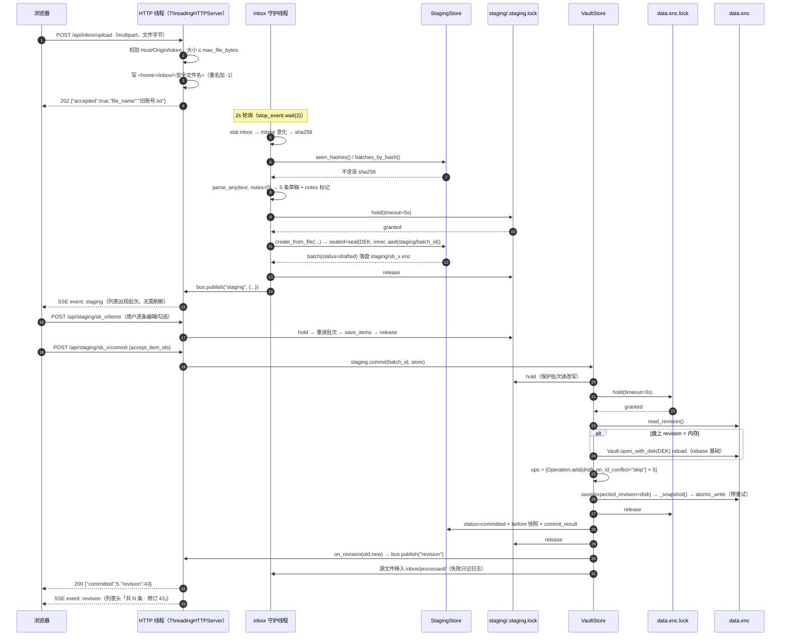
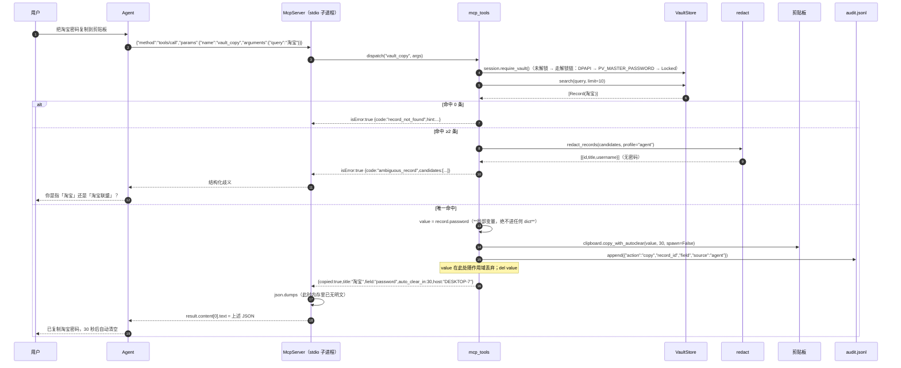
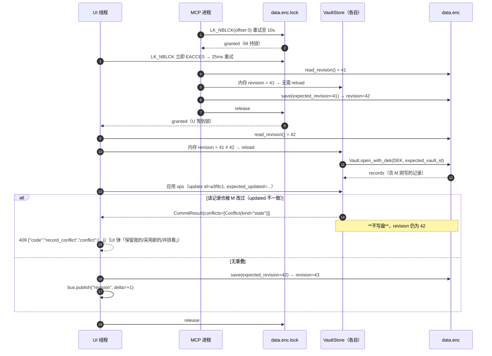
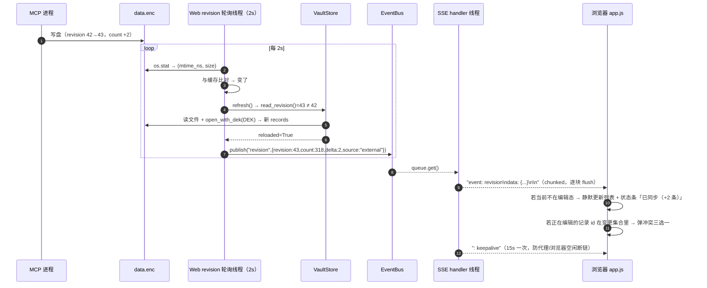

# pwdvault v1.1 增量架构设计

> 输入：`docs/PRD-v1.1.md`（需求唯一来源）、`docs/decisions-v1.1.md`、v1.0 全部源码（已逐行读过）。
> 本文是**实施规格**，不是方案建议。每一条都给出唯一结论，工程师照做即可。
> 三条覆盖性裁决（已落实在本文，与 PRD 冲突处以本文为准）：
> 1. **零新增第三方依赖**。PRD §1.1 的 `mcp` optional dependency 作废 → 自研 stdio JSON-RPC 2.0 最小服务端（`mcp_server.py`）。
> 2. **Web 层用 stdlib `http.server.ThreadingHTTPServer`**，SSE 手写 chunked，前端原生 HTML/CSS/JS 无构建。
> 3. **本次迭代做完全部 P0（12 项）**，P1 只留接口与扩展点。

---

## 0. 实施前必须知道的三个事实（已核实，不是记忆）

| # | 事实 | 依据 | 对设计的影响 |
|---|---|---|---|
| F1 | MCP stdio 传输是 **newline-delimited JSON**，不是 `Content-Length` 头 | 官方规范 2025-06-18 `basic/transports#stdio`：「Messages are delimited by newlines, and **MUST NOT** contain embedded newlines」「The server **MUST NOT** write anything to its `stdout` that is not a valid MCP message」 | 每条消息 = `json.dumps(..., separators=(",",":"), ensure_ascii=False)` + `"\n"`；`json.dumps` 默认会把字符串内换行转义成 `\n`，天然满足无内嵌换行。**进程内任何 `print()` 都会破坏协议**，见 §7.4 |
| F2 | `msvcrt.locking` **同进程换个句柄再锁会立即失败** `EACCES`，**不可重入** | 本机实测（Windows）：f1 锁成功 → f2 同进程 `LK_NBLCK` 立即 `OSError errno=13 EACCES`；`LK_LOCK`（阻塞版）内部重试 10 次后 `errno=36 EDEADLOCK` 约 9.06s 抛错 | 必须自己做「进程内 `threading.RLock` + 重入深度计数 + 自管超时重试」，**不能**靠 `LK_LOCK`，否则超时值不受控（见 §3.2） |
| F3 | Windows 上 `os.replace` 在目标文件被他人打开读时可能抛 `PermissionError`（共享冲突），网盘/杀软会放大 | 已知 Windows 语义 | `atomic_write` 必须加有界重试（v1.0 无重试，这是本次并发迭代引入的新暴露面），见 §4.5 |

协议版本策略：服务端支持 `2025-06-18`（首选）/ `2025-03-26` / `2024-11-05`。客户端 `protocolVersion` 在列表内则**原样回显**；不在列表内则回显自己最新的 `2025-06-18`（规范要求：支持就回同一个，不支持就回自己最新的）。三条版本的 stdio 帧格式一致（都是 newline-delimited），所以一个实现通吃。

---

## 1. 实现方案总览

### 1.1 分层与依赖方向（硬约束：只允许箭头向下）

```
L6  cli.py                         ← 只做参数解析与装配，不放业务
    ├──> web/server.py
    └──> mcp_server.py
L5  web/server.py  mcp_server.py   ← 传输层：HTTP 报文 / JSON-RPC 帧
L4  web/api.py  web/events.py  web/session.py      mcp_tools.py
L3  staging.py  inbox.py  service.py  audit.py  runtime.py
L2  locks.py  importers.py  clipboard.py  redact.py
L1  vault.py
L0  crypto.py  dpapi.py  models.py  errors.py  config.py
```

**禁止的 import（写进 code review 检查项）**

| 文件 | 禁止 import |
|---|---|
| `crypto.py` `models.py` `errors.py` `config.py` | 任何同包其他模块（`models` 目前就只 import `errors`，保持） |
| `vault.py` | `service` `locks` `staging` `web` `mcp_*` |
| `locks.py` | `service` `staging` `inbox` `web` `mcp_*` `cli` ← **本文件不得依赖业务层**，它只认 `Vault`、`Record`、`Operation` |
| `redact.py` | `staging` `service`（只认 `models.Record`） |
| `staging.py` | `web` `mcp_*` `cli` |
| `service.py` | `staging` `locks` `web` `mcp_*`（v1.0 现状保持：只认 `Vault`） |
| `web/*` `mcp_*` | `cli` |

`locks.py` 之所以能不 import `service` 就完成 rebase：记录级字段应用逻辑下沉为 `Record.apply_changes(changes)`（`models.py`），`service.update()` 改为调用它。这样「未知键落自定义字段 / tags 逗号切分 / pw_changed 时间戳」只有一份实现，`locks.py` 只依赖 `models`。

### 1.2 核心机制一句话

- **写**：任何写都变成 `Operation` 列表 → `VaultStore.commit()` 在**跨进程文件锁**内重读盘上 revision → 不一致就 reload 再按记录级操作 rebase → 一次原子写。调用方永远不"保存整个 vault"。
- **暂存区**：8 状态机 + 单文件加密批次；两个生产者（本地解析器 / Agent），人在 UI 确认才入库。
- **密码不出进程（到 Agent）**：`redact.py` 是唯一出口，MCP 侧 `reveal_fields` 恒为空集，用哨兵字符串做可断言测试。
- **双进程同步**：不搞 IPC / watchdog，Web 进程用 2 秒 `stat()` 轮询 `data.enc`（mtime+size 门控）+ 读头比对 revision，变了就 reload 并推 SSE。

---

## 2. 文件清单

### 2.1 新增文件

| # | 路径 | 职责（一句话） | 预估行数 |
|---|---|---|---|
| N1 | `pwdvault/locks.py` | `Operation`/`Conflict`/`CommitResult`、跨进程 `LockManager`、唯一写入口 `VaultStore` | 260 |
| N2 | `pwdvault/staging.py` | `StagingBatch`/`StagingItem`/`Warning`、13 条状态转换、加密持久化、commit/rollback、8 类校验 | 640 |
| N3 | `pwdvault/inbox.py` | inbox 目录 2 秒轮询、sha256 去重、墓碑、processed 归档、干净停止 | 250 |
| N4 | `pwdvault/redact.py` | 唯一脱敏出口：`is_sensitive_key`/`mask_value`/`redact_record`/`redact_records` | 150 |
| N5 | `pwdvault/runtime.py` | `runtime.json` 读写探测、存活检查、P1 代理接口桩 | 110 |
| N6 | `pwdvault/mcp_server.py` | stdio 帧、JSON-RPC 分发、initialize/tools/* 子集、解锁链、空闲自锁 | 470 |
| N7 | `pwdvault/mcp_tools.py` | 10 个 `vault_*` 工具的定义（schema）、参数校验、handler | 660 |
| N8 | `pwdvault/audit.py` | `logs/audit.jsonl` 追加（只记 id/字段名/动作/来源），P0 只覆盖 copy/add/update | 100 |
| N9 | `pwdvault/web/__init__.py` | 包标记 + `serve()` 导出 | 15 |
| N10 | `pwdvault/web/server.py` | `ThreadingHTTPServer`、路由表、Host/Origin/token 三件套、静态托管、chunked SSE 写 | 520 |
| N11 | `pwdvault/web/api.py` | 18 个 `/api/*` handler（记录/暂存/inbox/健康/设置/会话） | 680 |
| N12 | `pwdvault/web/session.py` | `AppState`：Vault 会话、DEK、空闲自锁、revision 轮询线程、Agent 在线探测 | 230 |
| N13 | `pwdvault/web/events.py` | `EventBus`（每客户端 `queue.Queue`）+ SSE 编码 | 160 |
| N14 | `pwdvault/web/static/index.html` | 单页骨架（4 视图：解锁/主界面/待整理/设置/健康） | 420 |
| N15 | `pwdvault/web/static/app.css` | 双主题设计令牌 + 全部组件样式 | 760 |
| N16 | `pwdvault/web/static/app.js` | 状态、渲染、事件、SSE、键盘、剪贴板回执（无框架、无 innerHTML 注入数据） | 980 |
| N17 | `tests/test_locks.py` | 锁/重入/超时 + **多进程** rebase 与冲突 | 300 |
| N18 | `tests/test_staging.py` | 状态机 13 条 + 8 类警告 + 加解密 + commit/rollback | 420 |
| N19 | `tests/test_inbox.py` | 扫描幂等、墓碑、停止 | 150 |
| N20 | `tests/test_mcp_protocol.py` | 帧格式、方法分发、错误码、stdout 纯净性 | 240 |
| N21 | `tests/test_mcp_tools.py` | 10 工具参数与返回体 + **哨兵断言** | 400 |
| N22 | `tests/test_web.py` | Host/token/穿越/Content-Length/SSE 格式 | 280 |
| N23 | `tests/test_web_api.py` | 18 endpoint 各 1 例 + 掩码/reveal/409 | 380 |
| N24 | `tests/test_redact.py` | 敏感键判定 12 例 + 掩码 + 嵌套脱敏 | 160 |
| N25 | `tests/_support.py` | 测试夹具：`make_vault()`、`SENTINEL`、`run_py()`（子进程执行器，**不匹配 `test*.py`**，不会被 discover 收集） | 120 |
| N26 | `tests/_locker.py` | 被 N17 以子进程启动的锁竞争者（写 start/end 标记） | 40 |
| N27 | `tests/test_integration.py` | 端到端：拖入→草稿→确认→入库→SSE→回滚 | 220 |

后端新增 ≈ 3400 行，前端 ≈ 2160 行，测试 ≈ 2910 行。

### 2.2 修改文件

| # | 路径 | 改动点 | 风险 |
|---|---|---|---|
| M1 | `pwdvault/errors.py` | 新增 `LockTimeout`(`lock_timeout`) / `RecordConflict`(`record_conflict`) / `StagingBusy`(`staging_busy`) / `Locked`(`locked`) / `StaleWrite`(`stale_write`) / `StagingNotFound`(`staging_not_found`) / `VaultReplaced`(`vault_replaced`)。全部 `VaultError` 子类，不改 `to_dict()` | 低 |
| M2 | `pwdvault/config.py` | `Settings` 加 5 组字段（`web`/`inbox`/`staging`/`mcp`/`lock`，均为扁平 `dataclass` 或 `dict`），`load_settings` 解析新 TOML 段。**保留旧字段与默认值不变** | 低（只加不删） |
| M3 | `pwdvault/models.py` | 新增 `is_sensitive_key()` / `mask_value()` / `Record.apply_changes(changes) -> bool` / `to_dict(mask_secrets=False)`；`apply_changes` 从 `service.update` 平移过来（未知键→`fields`、`tags` 逗号切分、`pw_changed`） | 中：必须与 `service.update` 字节级等价，靠现有 2 个测试守住 |
| M4 | `pwdvault/vault.py` | `save(expected_revision=None)`；抽出 `read_header()` / `read_revision()`；新增 `open_with_dek()`（复用头部校验，跳过 KDF，用于 rebase reload）；新增 `snapshot_now()`；`atomic_write` 加共享冲突重试。**`_snapshot()`/`_rotate_snapshots()` 逻辑一行不动** | 中：`save()` 语义必须保持向后兼容（默认不校验） |
| M5 | `pwdvault/service.py` | `update()` 委托 `Record.apply_changes`；新增 `validate_records(vault, records, *, seen=None) -> list[list[Warning]]`；`merge_import(apply=False)` 逐条返回 `warnings`（保留原 `details` 键，不做破坏性改名）；新增 `copy_field(vault, record, field, *, seconds) -> dict`（UI 与 MCP 共用，含审计） | 中：`merge_import` 返回体只加键不改键 |
| M6 | `pwdvault/importers.py` | `parse_any(text, *, filename="", fmt=None, source_name=None, notes=None)`；`_build(items, *, notes=None)` 在归一化**前**扫描原始键值，向 `notes` 追加 `(index, code)`（`password_trimmed` / `title_inferred` / `long_value`）。`notes=None` 时行为与 v1.0 完全一致 | 低：解析结果不变 |
| M7 | `pwdvault/clipboard.py` | 新增 `copy_with_autoclear(text, seconds, *, spawn=False)`：长驻进程（web/mcp）走**进程内 `threading.Timer`**，避免 `spawn_clear_watcher` 对 `sys.argv[0].endswith(".py")` 的依赖（pip 安装/打包后该判断会失效）。原函数保留不动 | 低 |
| M8 | `pwdvault/cli.py` | 新增 `web` / `mcp` 子命令；`save_or_fail()` 改为「加锁 + revision 校验 + 拒绝静默覆盖」 | 中 |
| M9 | `pwdvault/__init__.py` | `__version__ = "1.1.0"` | 无 |
| M10 | `README.md` | 新增两段：`pv web` / `pv mcp` 用法、MCP 配置示例 | 无 |

`data.enc` 的 payload schema、`Record` 结构、`ALIASES`、快照格式：**零改动，无需迁移**。

---

## 3. 核心数据结构与接口签名

### 3.1 `models.py` 增量（M3）

```python
SENSITIVE_TOKENS: tuple[str, ...] = (
    "secret", "key", "token", "pass", "pwd", "pin", "seed",
    "私钥", "密钥", "令牌", "口令", "种子",
)
NON_SENSITIVE_KEYS = frozenset({"title", "username", "url", "notes", "tags",
                               "created", "updated", "pw_changed", "id"})
MASK = "••••"          # 长度零泄露，固定四字符

def is_sensitive_key(name: str) -> bool:
    """规则（PRD §7.1）：
    1. 标准非敏感字段（title/username/url/notes/tags/created/updated/pw_changed/id）→ False（先判，避免 notes 被误伤）
    2. 以 "*" 开头 → True（人工强制标记，v1.0 打开只多显示一个星号，向前兼容）
    3. 小写 + 去掉全部空白后含任一 SENSITIVE_TOKENS → True
    已知误报（可接受，宁枉勿纵）：shipping / keyboard / monkey / 备注里写 "key" 的自定义字段名。
    """

def mask_value(value: str) -> str:
    """非空 → "••••"；空 → "（空）"。绝不返回原值长度信息。"""

@dataclass
class Record:
    ...
    def apply_changes(self, changes: dict[str, Any]) -> bool:
        """就地应用字段变更，返回是否改了 password。
        语义 = v1.0 service.update 的逐字平移：
          - value is None → 跳过
          - key == "tags" → 逗号切分
          - key == "fields" → 跳过
          - hasattr(self, key) → setattr（含 password 变更时置 pw_changed）
          - 否则 → self.fields[key] = value
        """

    def to_dict(self, *, mask_secrets: bool = False) -> dict:
        """mask_secrets=True 时 password/totp/敏感自定义字段值 → MASK。
        默认 False，v1.0 落盘路径 serialize_payload 用的就是默认值，落盘格式不变。"""
```

### 3.2 `locks.py`（N1）

```python
OpKind = Literal["add", "update", "delete"]

@dataclass(frozen=True)
class Operation:
    kind: OpKind
    record_id: str | None = None
    record: Record | None = None              # add
    changes: dict[str, Any] | None = None     # update
    expected_updated: str | None = None       # update 乐观锁
    on_id_conflict: Literal["reassign", "skip"] = "reassign"

    @classmethod
    def add(cls, record: Record, *, on_id_conflict="reassign") -> "Operation": ...
    @classmethod
    def update(cls, record_id: str, changes: dict[str, Any], *,
               expected_updated: str | None = None) -> "Operation": ...
    @classmethod
    def delete(cls, record_id: str) -> "Operation": ...

@dataclass(frozen=True)
class Conflict:
    record_id: str
    kind: Literal["stale", "deleted"]    # stale=对方改过 / deleted=对方删了
    mine: dict                           # 我们的意图（changes）
    theirs: dict | None                  # 盘上现状，**已脱敏**
    # 由 public_view() 生成，脱敏在 VaultStore 内部完成，不依赖调用方自觉

@dataclass
class CommitResult:
    revision: int
    added: int
    updated: int
    deleted: int
    applied_ids: list[str]
    conflicts: list[Conflict]
    reloaded: bool          # 是否发生过 rebase
    disk_revision: int      # 提交后盘上 revision

class LockManager:
    """data.enc 的跨进程独占锁。

    实现（三个层次，缺一不可）：
      1. 进程内：按 (设备,inode/规范化路径) 缓存一个 threading.RLock —— 让同进程多线程排队，
         而不是靠文件锁互相 EACCES 空转；它同时充当「内存 Vault 的数据锁」。
      2. 重入：threading.local 记 depth。depth>0 直接放行，**绝不第二次调用 msvcrt.locking**
         （F2：同进程换句柄再锁会立刻 EACCES，且 RLock 允许同线程重入）。
      3. 跨进程：msvcrt.locking(fd, LK_NBLCK, 1) 于 offset 0，自管重试：
         while now < deadline: try; except OSError: sleep(poll); 到期抛 LockTimeout。
         不用 LK_LOCK（F2：内部固定重试 10 次 ≈9s 后 EDEADLOCK，超时不可控）。
    非 Windows：fcntl.flock(fd, LOCK_EX | LOCK_NB) 同样自管重试（测试可在 Linux 跑）。
    """

    def __init__(self, lock_path: Path, *, default_timeout: float = 3.0,
                 poll_seconds: float = 0.025) -> None: ...
    @contextmanager
    def hold(self, *, timeout: float | None = None, purpose: str = "") -> Iterator[None]:
        """拿不到锁 → raise LockTimeout(timeout=..., purpose=...)。
        退出时按 depth 归零才真正解锁并释放 fd（fd 随句柄销毁自动解锁，避免泄漏）。"""
    def busy(self) -> bool:
        """非阻塞探测：别人（含同进程其他线程）是否持有。给 UI 状态条用。"""

class VaultStore:
    """全项目唯一允许写 data.enc 的对象。持有一份 Vault + 一把 LockManager。"""
    def __init__(self, settings: Settings, vault: Vault, *,
                 on_revision: Callable[[int, int], None] | None = None) -> None: ...
    @property
    def vault(self) -> Vault:
        """当前视图。**必须在锁内使用且不得长期缓存**：
        commit() 发生 rebase 时会替换为新的 Vault 对象，旧引用上的 records 已过期。"""
    def revision(self) -> int: ...
    def disk_revision(self) -> int: ...        # 只读盘，不加锁（原子 rename 保证一致性）
    def refresh(self) -> bool:
        """盘上 revision 变了就 reload（不加锁），返回是否变化。SSE 轮询线程调它。"""
    def mutate_header(self, fn: Callable[[dict], None], *, timeout: float = 3.0) -> int:
        """改主密码 / 开关本机免密 / 重置恢复码专用：
        锁内 reload → fn(fresh_header) → 写盘。防止用旧 header 覆盖别人的记录变更。"""
    def commit(self, operations: Sequence[Operation], *,
               expected_revision: int | None = None,
               timeout: float = 3.0,
               reload_policy: Literal["auto", "never", "force"] = "auto") -> CommitResult:
        """唯一写路径。返回时锁已释放。
        有 conflicts → **一个字节都没写**，revision 不变。"""

    # 内部
    def _emit(self, old: int, new: int) -> None: ...     # 调 on_revision 回调，不 import web
    def _redact_conflict(self, c: Conflict) -> Conflict: ...
```

`commit()` 精确算法（这是本次迭代最关键的 30 行）：

```
deadline = now + timeout
with lock.hold(timeout, purpose="commit"):
    disk = read_revision(path)                  # 盘上 revision（解析失败 → CorruptVault）
    if disk != self._vault.revision or reload_policy == "force":
        if reload_policy == "never": raise StaleWrite(...)
        fresh = Vault.open_with_dek(settings, self._dek, expected_vault_id=self._vault.vault_id)
        # vault_id 不符 → VaultReplaced（库被重建，DEK 已失效，必须重新解锁）
        self._vault = fresh; reloaded = True
    if expected_revision is not None and disk != expected_revision:
        # 调用方明确要求「我基于 R 提交」，而盘上不是 R
        → 走冲突路径：不 reload，直接对 expected_revision 做比对，按操作逐条判冲突
    for op in operations:
        add    : id 已存在 → on_id_conflict=="skip" ? 跳过 : record.id = new_id() 后追加
        update : 找不到 → Conflict(kind="deleted")
                 有 expected_updated 且 record.updated != expected_updated → Conflict(kind="stale")
                 否则 record.apply_changes(op.changes)
        delete : 找不到 → 幂等忽略（不算冲突）；否则移除
    if conflicts: return CommitResult(conflicts=..., revision=disk, 未写)
    if 净变化为 0: return CommitResult(revision=disk, 未写)    # 不空转 bump revision
    self._vault.save(expected_revision=disk)     # 内部：_snapshot() → atomic_write 重试 → revision=disk+1
    self._emit(disk, self._vault.revision)
    return CommitResult(...)
```

**约定**：`Vault.save()` **自己不加锁**，锁由调用方持有（`VaultStore.commit` / `cli.save_or_fail`）。它只做 `expected_revision` 断言（防御性 redundant check，成本一次头部解析）。

**为什么这样不破坏现有 69 个测试**：`save()` 新参数有默认值 `None`（不校验）；`Vault.create/open` 签名只加可选参数；`service.update` 行为等价平移；`merge_import` 只加键。全部改动对旧调用路径保持向后兼容。

### 3.3 `staging.py`（N2）

```python
Level = Literal["error", "warn", "info", "conflict"]

@dataclass(frozen=True)
class Warning:
    code: str        # title_missing / empty_record / password_trimmed / phone_username
                     # / password_equals_username / long_password / base32_in_field / duplicate_record
    level: Level
    message: str     # 中文，**只含字段名与规则描述，绝不含字段值**
    field: str | None = None

@dataclass
class StagingItem:
    item_id: str                      # "it_" + token_hex(4)
    draft: Record                     # 记录本身（含明文，只存在于加密区与内存）
    origin: Literal["local", "agent"]
    accepted: bool = True
    edited: bool = False
    warnings: list[Warning] = field(default_factory=list)
    conflict: dict | None = None      # {"with_id","with_title","resolution":"skip"|"overwrite"|"append"}
    before: dict | None = None        # 覆盖提交前的 Record.to_dict() 全量快照（撤销用；在加密区）

    def to_public(self, *, reveal: frozenset[str] = frozenset()) -> dict: ...

@dataclass
class StagingBatch:
    batch_id: str                     # "sb_" + token_hex(6)
    status: BatchStatus               # 8 态 Literal
    source: SourceInfo                # file_name / sha256 / size / inbox_rel_path / detected_at / moved_to
    items: list[StagingItem]
    origin: Literal["local", "agent"]
    created: str
    updated: str
    lease: Lease | None               # {"holder","acquired","expires"}
    editor: EditorLock | None         # {"holder","since"}  review/reviewing 的编辑锁
    commit: CommitInfo | None         # {"revision","at","intent","result"}
    notes: str                        # Agent 交回的一句话总结（明文可读，不含值）

BatchStatus = Literal["detected","drafted","failed","refining","review",
                      "reviewing","committed","rolled_back","discarded"]
```

`ALLOWED_TRANSITIONS`（唯一状态变更入口 `transition()` 校验，非法 → `StagingBusy`）：

```python
{"detected":   {"drafted","failed","refining","discarded"},
 "drafted":    {"refining","review","discarded"},
 "failed":     {"refining","review","discarded"},
 "refining":   {"review","drafted","failed","discarded"},   # drafted/failed = lease 过期回落
 "review":     {"reviewing","committed","discarded"},
 "reviewing":  {"review","committed","discarded"},
 "committed":  {"rolled_back"},
 "rolled_back":{"discarded"},
 "discarded":  set()}
```
13 条转换 = 上表全部边（含 `reviewing→review` 编辑保存回归、`committed→rolled_back`、`refining→drafted` lease 回落）。`rolled_back→discarded` 是清理入口（额外，不违背 PRD）。

```python
class StagingStore:
    """进程内单例（按 vault home 缓存，`threading.Lock` 保护 registry），
    跨进程用 staging/.staging.lock 串行化所有批次文件的读-改-写。"""

    def __init__(self, settings: Settings, dek_provider: Callable[[], bytes | None]) -> None: ...
    # dek_provider 在未解锁时返回 None → 只允许读墓碑/扫目录，不允许建批次

    def list_batches(self, *, statuses: Sequence[BatchStatus] | None = None,
                     include_finished: bool = False) -> list[StagingBatch]: ...
    def get(self, batch_id: str) -> StagingBatch: ...
    def create_from_file(self, *, path: Path, text: str, drafts: list[Record],
                         notes: Sequence[tuple[int, str]] = (),
                         origin: Literal["local","agent"] = "local") -> StagingBatch: ...
    def create_manual(self, *, source_name: str = "手动新建") -> StagingBatch: ...
    def claim(self, batch_id: str, *, holder: str = "agent",
              lease_seconds: int = 180) -> StagingBatch:
        """refining；已被有效 lease 占用 → StagingBusy；review/reviewing/committed → StagingBusy。"""
    def submit(self, batch_id: str, records: Sequence[Record], *,
               holder: str = "agent", summary: str = "") -> StagingBatch:
        """写草稿，状态 → review。持 lease 才允许；review/reviewing → StagingBusy。"""
    def save_items(self, batch_id: str, items: Sequence[StagingItem], *,
                   editor: str = "ui") -> StagingBatch: ...
    def begin_edit(self, batch_id: str, *, holder: str = "ui") -> StagingBatch:  # review→reviewing
    def end_edit(self, batch_id: str) -> StagingBatch: ...                       # reviewing→review
    def commit(self, batch_id: str, *, store: VaultStore,
               accept_item_ids: set[str] | None = None,
               mode: Literal["skip","overwrite","append"] = "skip",
               timeout: float = 3.0) -> dict: ...
    def rollback(self, batch_id: str, *, store: VaultStore) -> dict: ...
    def discard(self, batch_id: str, *, delete_source: bool = False) -> None: ...
    def expire_leases(self) -> int:
        """refining + 过期 → 有本地草稿回 drafted，否则 failed。list()/get() 时惰性调用。"""
    def tombstone(self, sha256_hex: str, file_name: str) -> None: ...
    def seen_hashes(self) -> set[str]: ...
    def batches_by_hash(self) -> dict[str, str]: ...     # sha256 → batch_id（重启后去重靠它）
    def inbox_pending(self) -> int: ...
```

`commit()` 的原子性与幂等：

```
1. 锁 staging：重读批次；status 必须 ∈ {review, reviewing}，否则 StagingBusy
2. status → reviewing（拿编辑锁），把 `commit.intent = {"at","item_ids"}` 写进加密区（断电可诊断）
3. 组装 ops：
   - 每条的 resolution：skip → 不生成 op；overwrite → Operation.update(existing_id, changes=draft.to_dict(),
     expected_updated=existing.updated)；append/无冲突 → Operation.add(draft, on_id_conflict="skip")
   - **on_id_conflict="skip" 是幂等关键**：上次中断后重放不会插出重复记录
4. store.commit(ops, timeout=...)；有 conflicts → 状态退回 review，返回冲突让 UI 三选一，**绝不半写**
5. 无冲突 → 写入每条的 before 快照（overwrite 情形取覆盖前 to_dict()）→ status=committed，
   commit.result={"revision","at","added","updated"}；source 文件移入 inbox/processed/
6. 返回 {"status","revision","added","updated","skipped","rollback_hint"}
```

### 3.4 `inbox.py`（N3）

```python
class InboxWatcher:
    def __init__(self, settings: Settings, staging: StagingStore, *,
                 on_event: Callable[[str, dict], None] | None = None) -> None: ...
    def start(self) -> None:
        """threading.Thread(daemon=True, name="pv-inbox") 只起**一个**。
        循环：while not self._stop.wait(interval): self._tick()
        _tick 内 try/except 全捕获 → 写 stderr，连续失败 5 次把间隔退到 10s。
        绝不让异常杀死线程（静默失去功能比崩溃更难查）。"""
    def stop(self, *, timeout: float = 3.0) -> None:
        """set _stop，join(timeout)；超时只记日志不阻塞退出（daemon 会被进程带走）。"""
    def scan_once(self) -> list[str]:
        """同步扫一遍，返回新建 batch_id。测试直接调它，不依赖线程时序。"""
    def status(self) -> dict: ...   # {"watching","dir","interval","last_scan","pending","error_count"}

扫描算法（幂等，这是唯一正确性要求）：
  files = 目录下 mtime > last_mtime 且后缀 ∈ {txt,md,csv,tsv,json,log,dat,ini}
  for f:
      size > max_file_bytes → 跳过并在 status 里计数（不建批次、不报错）
      sha256 = 读全文哈希
      sha256 in tombstones  → 跳过
      sha256 in staging.batches_by_hash() → 跳过        ← 重启后不重复建批
      sha256 in 本次会话已见 → 跳过
      DEK 不可用（未解锁）→ **本轮不建批次**，只在 status 暴露 pending 数；解锁后下一 tick 自动补上
      text = 解码（utf-8 → utf-8-sig → gbk → latin-1 逐级回退，errors="replace" 兜底）
      drafts = parse_any(text, filename=f.name, source_name=f.name, notes=notes)
      batch = staging.create_from_file(...)   # 内部已把 detected→drafted/failed
      emit("staging", {...})
```

`processed/` 归档：只在 `commit` 成功后移动（`shutil.move`），失败吞掉异常仅记日志——文件移动失败不该让入库回滚。

### 3.5 `redact.py`（N4）

```python
Profile = Literal["agent", "ui"]

def redact_record(record: Record, *,
                  profile: Profile = "agent",
                  reveal_fields: Iterable[str] = ()) -> dict:
    """唯一出口。任何要跨进程返回的记录数据都必须经过这里。
    返回结构（键名固定，前端与 Agent 契约不漂移）：
    {
      "id", "title", "username", "url", "tags", "notes",
      "created", "updated", "pw_changed",
      "has_password": bool, "has_totp": bool,
      "password": MASK | "（空）",            # 仅 profile="ui" 且 reveal_fields 含 "password" 时给明文
      "totp":     MASK | "（空）",
      "fields":   {name: value},              # 敏感键的值 → MASK
      "secret_field_names": [name, ...],      # 敏感键只给名字
    }
    profile="agent" 时 reveal_fields 被**强制忽略**（代码里直接 return 脱敏版，不做条件分支），
    这样即使调用方传错参数也不可能泄密。"""

def redact_records(records, *, profile="agent", reveal_fields=()) -> list[dict]: ...
def public_error(exc: VaultError, *, candidates: list[dict] | None = None) -> dict:
    """{code, message, hint?, candidates?}。**不传 traceback，不传内部对象。**"""
def assert_no_secret(payload: Any, *probes: str) -> None:
    """测试用哨兵：递归遍历 payload（dict/list/str/bytes repr），命中任一探针即 AssertionError。"""
```

哨兵机制（可直接写进测试）：

```python
SENTINEL_PW    = "ZZ-PvProbe-Pw-9f2c1d-DO-NOT-LEAK"      # password 字段
SENTINEL_CUSTOM= "ZZ-PvProbe-Custom-4a7e-DO-NOT-LEAK"    # 字段名 "*AccessKey Secret" 的值
SENTINEL_NOTE  = "ZZ-PvProbe-Note-1b3f-VISIBLE-OK"       # 普通字段，**必须出现**（反向对照）
```
断言方式：把所有 MCP 工具返回值、所有 `/api/*` 响应体序列化成 `json.dumps(..., ensure_ascii=False)`，`assertNotIn(SENTINEL_PW, body)`。三个哨兵里第三个是**反向对照**，用来证明断言不是空转（如果哪天有人把 `username` 也误脱敏，第三个哨兵会失败）。

### 3.6 `mcp_server.py`（N6）

```python
PROTOCOL_VERSIONS = ("2025-06-18", "2025-03-26", "2024-11-05")
SERVER_INFO = {"name": "pwdvault", "title": "pwdvault 本地密码库", "version": "1.1.0"}

class StdioTransport:
    def read_message(self) -> dict | None:
        """sys.stdin.buffer 上按 \n 读一行（readline，不用 for 迭代以免缓冲问题）；
        跳过空行；超长行（> 8MB）丢弃并回 -32600；EOF → None。
        解码 utf-8（errors="replace"）后 json.loads；失败 → 返回 _ParseError 标记对象。"""
    def write_message(self, msg: dict) -> None:
        """line = json.dumps(msg, ensure_ascii=False, separators=(",",":"))
        sys.stdout.write(line + "\n"); sys.stdout.flush()
        （F1：无内嵌换行由 json.dumps 保证；必须显式 flush，不依赖行缓冲）"""

class McpServer:
    def __init__(self, settings: Settings, *, stdin=None, stdout=None,
                 session: "McpSession | None" = None) -> None: ...
    def serve_forever(self) -> int:
        """读-分发-写。EOF 或 KeyboardInterrupt → 清理 session（丢 DEK）→ return 0。"""
    def handle_message(self, msg: dict) -> dict | None:
        """纯函数式（便于单测）：返回 None 表示不回应（通知）。"""
```

分发规则：

| 输入 | 行为 |
|---|---|
| `method == "initialize"` | `result = {protocolVersion, capabilities:{tools:{}}, serverInfo, instructions}` |
| `method == "notifications/initialized"` | 无响应（无 id） |
| 其他 `notifications/*`（`cancelled` 等） | 无响应，记 stderr |
| `method == "ping"` | `result = {}` |
| `method == "tools/list"` | `result = {"tools": [10 个定义]}` |
| `method == "tools/call"` | 见 §7 |
| 未知 method + 有 id | `error {"code": -32601, "message": "Method not found: <m>"}` |
| 未知 method + 无 id | 无响应 |
| JSON 解析失败 | `error {"code": -32700, "id": null}` |
| `jsonrpc != "2.0"` / 非 dict / 缺 method | `error {"code": -32600, "id": <id or null>}` |
| handler 抛非 VaultError | `error {"code": -32603, "message": "internal error"}` + stderr 打印完整 traceback（**只在 stderr**） |

### 3.7 `web/session.py`（N12）

```python
class AppState:
    """Web 进程的全局状态。进程内唯一，被所有 handler 线程共享。"""
    settings: Settings
    store: VaultStore | None          # 解锁后非 None
    staging: StagingStore             # 单例，永远存在（未解锁时 dek_provider 返回 None）
    watcher: InboxWatcher | None
    bus: EventBus
    token: str                        # 一次性会话 token
    port: int
    agent_seen: float | None          # 最近一次探测到 runtime.json 的时间
    last_active: float                # 空闲自锁计时

    def unlock(self, *, password=None, recovery_code=None, use_dpapi=False) -> Vault: ...
    def lock(self) -> None: ...        # 丢 DEK、停 watcher、store=None、广播 session 事件
    def touch(self) -> None: ...       # 每次 /api/* 更新 last_active
    def require_unlocked(self) -> VaultStore: ...   # 否则 raise Locked
    def start_background(self, *, port: int) -> None:
        """两个 daemon 线程：
        (a) revision 轮询：每 2s stat(data.enc) 比 (mtime_ns,size)；变了 → store.refresh()
            → 变了就 bus.publish("revision", {...})。同时 stat(runtime.json) 维护 agent_seen。
        (b) 空闲自锁：每 5s 检查 now - last_active > auto_lock_seconds → lock()。"""
    def idle_seconds(self) -> int: ...
```

### 3.8 `web/events.py`（N13）

```python
class EventBus:
    def subscribe(self) -> "queue.Queue[tuple[str, dict]]":   # maxsize=64
    def unsubscribe(self, q) -> None: ...
    def publish(self, event: str, data: dict) -> None:
        """遍历订阅者 put_nowait；队列满 → 清空该队列并投一条 ("lag", {})，
        语义是「你落后了，请全量刷新」——比静默丢事件安全。"""
def encode_sse(event: str, data: dict) -> bytes:
    """b'event: %s\\ndata: %s\\n\\n' % (event, json.dumps(data, ensure_ascii=False))
    data 里不允许出现裸 \\n（json.dumps 会转义），所以不必多行 data:。"""
```

事件表（`event:` 名固定，前端按名订阅）：

| event | data |
|---|---|
| `session` | `{"unlocked":bool,"revision":int,"count":int,"auto_lock_in_seconds":int}` |
| `revision` | `{"revision":int,"count":int,"delta":int,"source":"ui"\|"agent"\|"cli","reloaded":bool}` |
| `staging` | `{"batch_id":str,"status":str,"item_count":int,"origin":"local"\|"agent","updated":iso}` |
| `agent` | `{"connected":bool}` |
| `lag` | `{}` → 前端全量刷新 |
| `: keepalive`（注释行） | 每 15s，无 data |

### 3.9 与 v1.0 的兼容矩阵（自检表）

| v1.0 调用点 | 现在走哪条路 | 是否改语义 |
|---|---|---|
| `pv add/find/show/copy/totp/edit/rm` | `cli.unlock()` → 内存 Vault 变更 → `save_or_fail()` → **加锁 + revision 校验** | 仅并发时会拒绝而不是静默覆盖（PRD 决策 4 第 4 条精神） |
| `pv import` | 同上，`merge_import` | 返回体只加键 |
| `pv passwd/recovery/local-unlock` | `VaultStore.mutate_header()` | 改 header 的路径更安全，UI 无感 |
| `vault.save()` 直接调用（测试大量使用） | 未变，`expected_revision` 默认 None | 语义不变 |
| `service.update/delete/add/search/resolve/health/merge_import` | 未变（`update` 内部委托） | 参数与返回体不变 |
| `importers.parse_any(text, filename=)` | 未变（新参数默认 None） | 解析结果不变 |
| `data.enc` 文件 | 完全不改格式 | 无迁移 |

---

## 4. 数据格式

### 4.1 `staging/<batch_id>.enc`（完整 schema）

外层明文（存在的目的是「不解锁也能判断有无待整理」——所以**只能放标识、状态、计数、时间**）：

```json
{
  "format": "pwdvault-staging",
  "version": 1,
  "vault_id": "3f9c1a2b4d5e6f70",
  "batch_id": "sb_9f3c1a2b4d",
  "status": "drafted",
  "origin": "local",
  "item_count": 5,
  "notes": "",
  "created": "2026-01-05T04:31:12+00:00",
  "updated": "2026-01-05T04:31:13+00:00",
  "source": {
    "file_name": "旧账号.txt",
    "sha256": "9d1f...c3",
    "size": 4821,
    "inbox_rel_path": "inbox/旧账号.txt",
    "moved_to": null,
    "detected_at": "2026-01-05T04:31:12+00:00",
    "format": "txt"
  },
  "lease": {"holder": "agent", "acquired": "...", "expires": "..."},
  "editor": null,
  "commit": null,
  "sealed": {"nonce": "<b64,12B>", "ct": "<b64>"}
}
```

**明文可读性与泄露审查**：`file_name` 是用户自己的文件名（可能含站点名，但不是记录内容）；`sha256/size` 是文件指纹；`status/item_count/origin/lease/editor/commit` 是状态机数据；`notes` 是 Agent 的一句话总结，**规定不得包含任何字段值**（prompt 里写死，校验里截断到 200 字符）。**没有任何一条记录的字段值在明文区**。

内层加密区（`sealed.ct` 解密后）：

```json
{
  "schema": 1,
  "items": [
    {
      "item_id": "it_7a2c",
      "origin": "local",
      "accepted": true,
      "edited": false,
      "draft": { "...": "Record.to_dict() 全量，含 password/totp/自定义字段明文" },
      "warnings": [{"code": "password_equals_username", "level": "warn",
                    "message": "账号与密码相同", "field": "password"}],
      "conflict": {"with_id": "a3f9c1", "with_title": "淘宝", "resolution": "skip"},
      "before": null
    }
  ],
  "commit_intent": {"at": "...", "item_ids": ["it_7a2c"]},
  "commit_result": {"revision": 42, "added": 5, "updated": 0, "at": "..."}
}
```

加解密（**复用现有 `crypto` 原语，不新造密钥、不派生新密钥**）：

```python
# 密钥 = 已被 KEK 解包出来的 DEK（就是加密 data.enc payload 那一把）
# AAD = 与 wrap/payload 完全同风格：
#   make_aad(vault_id, "staging/<batch_id>")
#   → b"pwdvault/v1/<vault_id>/staging/sb_9f3c1a2b4d"
sealed = crypto.seal(dek, json.dumps(inner, ensure_ascii=False).encode("utf-8"),
                     crypto.make_aad(vault_id, f"staging/{batch_id}"))
```

为什么这样构造 AAD（三个具体收益，都可以写成测试）：
1. 把 staging 密文挪到 `data.enc` 的 `payload` 位置 → AAD 是 `.../payload`，`InvalidTag`，打不开。
2. 把 `sb_A.enc` 的 `sealed` 挪到 `sb_B.enc` → AAD 里含 `batch_id`，打不开（防批次身份混淆，因为 `batch_id` 在明文区可被改）。
3. 跨 vault 搬运 → `vault_id` 不同，打不开。这与 `wrap/password`、`payload` 的隔离强度一致。

### 4.2 `runtime.json`（0600，退出即删）

```json
{
  "format": "pwdvault-runtime",
  "version": 1,
  "pid": 24188,
  "host": "127.0.0.1",
  "port": 8765,
  "url": "http://127.0.0.1:8765/",
  "token": "8Kq2..._z1",
  "started": "2026-01-05T04:30:02+00:00",
  "version_app": "1.1.0",
  "vault_path": "<库目录>\\data.enc"
}
```
- 写入用 `vault.atomic_write` + `os.chmod(0o600)`（Windows 上 chmod 只影响只读位，实际保护靠用户目录 ACL —— **必须在 README 里写明这一点**，不要假装 0600 在 Windows 上有效）。
- 删除时机：`pv web` 的 `finally`；另外进程被强杀留下脏文件时，MCP 侧用 `pid` 存活检查（`psutil` 不可用 → Windows 用 `ctypes.windll.kernel32.OpenProcess`；探测失败按「不存活」处理）。
- **MCP 进程只读它，本迭代不据此转发**（P1 代理）。

### 4.3 `config.toml` 新增段

```toml
[vault]
path = "<项目目录>/demo/data.enc"   # 原有

[web]
host = "127.0.0.1"        # 只允许 127.0.0.1，配其它值直接拒绝启动
port = 8765               # 被占用顺延 +1，最多试 20 个
open_browser = true
session_max_age_hours = 24

[inbox]
dir = ""                  # 空 = <vault 目录>/inbox
enabled = true
interval_seconds = 2
max_file_bytes = 2097152  # 2MB，超出跳过并在 UI 显示
archive_processed = true

[staging]
lease_seconds = 180
lease_max_seconds = 600
ttl_days = 30
max_items = 500
max_raw_bytes = 204800    # claim 单批次原文上限 200KB，超出给游标

[mcp]
auto_lock_seconds = 900
proxy = true              # P1 预留，本迭代读但不生效
lock_timeout_seconds = 10

[lock]
timeout_seconds = 3       # UI
poll_seconds = 0.025
```

`Settings` 用扁平属性暴露（`settings.web_port` 等），避免 `settings.web.port` 这种两层访问在各处散开；`load_settings` 里做一次映射。

### 4.4 `staging/tombstones.json`

```json
{
  "format": "pwdvault-tombstones",
  "version": 1,
  "vault_id": "3f9c1a2b4d5e6f70",
  "entries": [
    {"sha256": "9d1f...c3", "file_name": "旧账号.txt",
     "discarded_at": "2026-01-05T04:31:12+00:00", "batch_id": "sb_9f3c1a2b4d"}
  ]
}
```

**决定：明文存储，不加密**（PRD §9 写的是「加密清单」，这里推翻并给理由，因为它是错的）：内容只有文件 sha256 + 文件名 + 时间，**不包含任何凭据**；而如果加密，`inbox` 监听在**未解锁时就无法判重**，会重复建批次——正好破坏它存在的目的。文件名本身在 `inbox/` 里就是明文，加密墓碑不增加任何安全性。

增长控制：`discard/commit` 时写入，`ttl_days` 之外的在每次 `StagingStore.__init__` 时清理；`entries > 5000` 时按时间裁到 5000。

### 4.5 `vault.py` 的 `atomic_write` 加固（M4，对应 F3）

```python
def atomic_write(path: Path, data: bytes) -> None:
    tmp = path.with_name(path.name + ".tmp")
    ... 写 + flush + fsync ...
    for attempt in range(6):                    # 20ms, 40, 80, 160, 320 → 上限 ~620ms
        try:
            os.replace(tmp, path); return
        except PermissionError:                 # Windows 共享冲突（网盘/杀软/别的进程在读）
            if attempt == 5: raise
            time.sleep(0.02 * (2 ** attempt))
```
`_snapshot()` 里的 `shutil.copy2` 同样包一层 `PermissionError` 重试（快照失败不该让入库失败 → 若是最终仍失败，**记 stderr 并继续写盘**，因为快照是保险不是主数据）。

---

## 5. 时序图

### 5.1 TXT 拖入 → 入库（跨 Web 主线程 + inbox 线程 + 两把锁）



### 5.2 Agent 调 `vault_copy`（唯一命中）



### 5.3 并发写 rebase（MCP 与 UI 同时写）



### 5.4 UI 通过 SSE 收到 MCP 写入



---

## 6. 状态机、锁、线程模型（关键结论集中回答）

### 6.1 8 状态 × 13 转换落地方式

- 唯一入口 `StagingStore.transition(batch_id, to, *, reason)`，内部查 `ALLOWED_TRANSITIONS`，非法抛 `StagingBusy`（`code="staging_busy"`，message 含当前状态与目标状态，**不含记录内容**）。
- **惰性自愈**：`list_batches()` / `get()` 先跑 `expire_leases()`。`refining` 且 `lease.expires < now` → 有本地草稿回 `drafted`，否则 `failed`。这样"僵尸批次"不需要额外定时器。
- **编辑锁**：进 `reviewing` 时写 `editor={"holder":"ui","since":iso}`；`editor` 存在时 Agent 的 `submit` 被拒（`staging_busy`）；`editor.since` 超 120s 视为失效（浏览器崩了不至于锁死批次）。
- **不阻塞原则**：`refining` 也允许 UI 直接 `→ review`（用本地草稿），即"就按本地结果确认"。

### 6.2 锁的正确性：四个必须写对的点

| # | 点 | 做法 | 写错的后果 |
|---|---|---|---|
| 1 | 同进程多线程不能靠文件锁互斥 | `LockManager` 内部先拿 `threading.RLock`（按锁文件路径缓存），再拿文件锁 | 线程 A 持锁写盘时线程 B 直接 `EACCES` 被当成"另一个窗口在写"，UI 随机报超时 |
| 2 | 同线程重入不能再调 `msvcrt.locking` | `threading.local().depth`；depth>0 直接放行 | **必然** `EACCES` 伪装成锁超时，且 stash/commit 嵌套调用时 100% 复现 |
| 3 | 超时必须自己控 | `LK_NBLCK` + `sleep(25ms)` 重试到 deadline | 用 `LK_LOCK` 会固定睡 ~9s 再 `EDEADLOCK`（F2 实测），UI 3s 超时形同虚设 |
| 4 | 读路径不加锁 | 读者直接读文件（`os.replace` 原子，读到的一定是完整旧版或完整新版） | 读写互锁，SSE 轮询线程会和写入者恶性竞争，UI 卡顿 |

### 6.3 双进程同步：为什么选 2 秒 stat 轮询（而不是 IPC/watchdog）

- `watchdog` 是第三方依赖 → 违反零新增依赖。
- 自建 IPC（named pipe / socket）需要 Web 与 MCP 建立连接、处理重连、处理"对方不在"，代码量与故障面都比一个问题大：**它是另一个分布式系统**。
- stat 轮询的代价：每 2 秒一次 `os.stat`，文件几百 KB 时 `read_revision` 才需要解析 JSON，且用 `(mtime_ns, size)` 门控 → 绝大多数 tick 只花一次 syscall。
- **已知代价与兜底**：即使 `mtime` 因文件系统时钟精度未变（Windows NTFS 100ns 精度，实际不会），下一 tick 的 `size` 或下一动作的 `commit`（会读 revision）仍能兜住；最坏情况是 UI 显示延迟 ≤2s，与 PRD 的 3 秒要求相符。
- `delta` 计算用 `count` 差值，`source` 由 revision 归属推断：本进程 `_last_self_revision` 相等 → `"ui"`，否则 `"external"`。不猜来源，只给"是不是我写的"。

### 6.4 inbox 线程与 HTTP 线程的配合

| 问题 | 做法 |
|---|---|
| 不重复处理 | 三重去重：`tombstones` ∪ `staging.batches_by_hash()` ∪ 本会话 `_seen`。**必须包含 staging 扫描**，否则进程重启后给同一个文件再建一批 |
| 与锁配合 | 建批次只碰 `staging/.staging.lock`（5s），**从不碰** `data.enc.lock`。入库是用户点提交时由 HTTP 线程做的，那条路才需要 vault 锁 |
| 只有一个线程 | `start()` 幂等（已 `is_alive()` 就返回）；`scan_once()` 供测试同步调用 |
| 未解锁 | 只扫不建：本轮把 `pending` 数放进 `status()`，`dek_provider()` 返回 None 就不写批次。解锁后下一 tick 自动补 |
| 干净停止 | `stop_event.wait(interval)` 而不是 `time.sleep`（sleep 会让 Ctrl+C 等满 2 秒）；`pv web` 的 `finally: watcher.stop(3.0); server.server_close(); runtime.unlink()` |
| 出错不静默 | 全捕获 → stderr 一行；连续 5 次错误间隔退到 10s；`status()["error_count"]` 暴露给 UI 状态条 |

---

## 7. MCP 协议实现细节

### 7.1 帧格式（F1）

```
每个消息 = 一行 UTF-8 JSON + "\n"，无 Content-Length，无内嵌换行
```
```python
# 写
line = json.dumps(msg, ensure_ascii=False, separators=(",", ":"))
stdout.write(line + "\n"); stdout.flush()
# 读
raw = stdin.buffer.readline()          # EOF → b""
if not raw: return None
raw = raw.strip()
if not raw: continue                   # 忽略空行（宽容）
msg = json.loads(raw.decode("utf-8", errors="replace"))
```
依据：规范原文「Messages are delimited by newlines, and MUST NOT contain embedded newlines」（`basic/transports#stdio`）。因此**不使用** LSP 风格的 `Content-Length: N\r\n\r\n` 头。

### 7.2 `initialize`

请求：
```json
{"jsonrpc":"2.0","id":1,"method":"initialize","params":{"protocolVersion":"2025-06-18","capabilities":{"roots":{"listChanged":true}},"clientInfo":{"name":"WorkBuddy","version":"2.3.0"}}}
```
响应：
```json
{"jsonrpc":"2.0","id":1,"result":{
  "protocolVersion":"2025-06-18",
  "capabilities":{"tools":{}},
  "serverInfo":{"name":"pwdvault","title":"pwdvault 本地密码库","version":"1.1.0"},
  "instructions":"本机密码库。规则：1) 用户要『用』密码时用 vault_copy，它不返回明文；2) 用户要『看』账号/网址时用 vault_search 或 vault_get，密码永远只显示掩码；3) 匹配到多条时不要猜，把候选回问用户；4) 批量整理走 vault_staging_*，你没有落库权限，不要尝试；5) 任何情况下都不要把字段值念进对话。"}}
```
`capabilities.tools` 用 `{}`（工具表静态，不发 `notifications/tools/list_changed`，因此不声明 `listChanged`）。

客户端若不发 `notifications/initialized` 就直接 `tools/list`：**宽容放行**（记一条 stderr），因为不同客户端启动顺序有差异，为此拒绝调用得不偿失。

### 7.3 `tools/list`（节选 2 个，其余同构）

```json
{"jsonrpc":"2.0","id":2,"result":{"tools":[
  {"name":"vault_status","title":"密码库状态",
   "description":"库是否可用、锁没锁、有几条、有几件待整理。任何操作前想了解现状时先调我。",
   "inputSchema":{"type":"object","properties":{},"additionalProperties":false}},
  {"name":"vault_copy","title":"把字段复制到剪贴板",
   "description":"把某个字段的值复制到用户剪贴板。用户要『用』密码/账号/网址/动态码时用我。我不返回明文，复制即完成。",
   "inputSchema":{"type":"object","properties":{
      "id":{"type":"string","description":"记录 id（与 query 二选一，优先 id）"},
      "query":{"type":"string","description":"关键词，支持 tag:/user:/title: 前缀"},
      "field":{"type":"string","default":"password","description":"password/username/url/totp 或自定义字段名"}},
    "anyOf":[{"required":["id"]},{"required":["query"]}],"additionalProperties":false}}
]}}
```
不返回 `nextCursor`（不分页）；不提供 `outputSchema`（返回值形态随业务变化，用 `structuredContent` 保持一致即可）。

### 7.4 `tools/call`：成功与三种失败

成功：
```json
{"jsonrpc":"2.0","id":3,"result":{
  "content":[{"type":"text","text":"{\"count\":1,\"records\":[{\"id\":\"a3f9c1\",\"title\":\"淘宝\",\"username\":\"zhangsan\",\"url\":\"https://taobao.com\",\"tags\":[\"购物\"],\"has_password\":true,\"has_totp\":false,\"secret_field_names\":[\"*AccessKey Secret\"],\"updated\":\"2026-01-05T04:31:12+00:00\"}]}"}],
  "structuredContent":{"count":1,"records":["...同上..."]},
  "isError":false}}
```
业务错误（`isError: true`，**HTTP/协议层成功**）：
```json
{"jsonrpc":"2.0","id":4,"result":{
  "content":[{"type":"text","text":"{\"code\":\"ambiguous_record\",\"message\":\"“淘宝”匹配到 2 条记录\",\"hint\":\"请回问用户是哪一个，或改用 id。\",\"candidates\":[{\"id\":\"a3f9c1\",\"title\":\"淘宝\",\"username\":\"zhangsan\"},{\"id\":\"b7d2e4\",\"title\":\"淘宝联盟\",\"username\":\"zhangsan\"}]}"}],
  "structuredContent":{"code":"ambiguous_record","candidates":["..."]},
  "isError":true}}
```
协议错误（未知工具 / 参数不合法）：
```json
{"jsonrpc":"2.0","id":5,"error":{"code":-32602,"message":"Unknown tool: vault_delete"}}
{"jsonrpc":"2.0","id":6,"error":{"code":-32602,"message":"Invalid arguments for vault_copy: missing one of id/query"}}
{"jsonrpc":"2.0","id":7,"error":{"code":-32601,"message":"Method not found: tools/subscribe"}}
{"jsonrpc":"2.0","id":null,"error":{"code":-32700,"message":"Parse error"}}
```

### 7.5 错误码映射表

| 来源 | 映射 |
|---|---|
| `VaultError` 及子类（`locked`/`record_not_found`/`ambiguous_record`/`record_conflict`/`staging_busy`/`lock_timeout`/`invalid_record`/`auth_failed`/`vault_not_found`/`vault_corrupt`/`refused`/`stale_write`…） | `result.isError=true` + `structuredContent={code,message,hint?,candidates?}`。`code` **原样复用** `errors.py` 的 `code` |
| 未知工具名 | JSON-RPC `-32602`（规范明确「Unknown tools」属协议错误） |
| 参数不满足 `inputSchema` | JSON-RPC `-32602` |
| 未知 method | JSON-RPC `-32601` |
| 非 JSON / 非法 JSON-RPC | `-32700` / `-32600` |
| 未预期异常（`Exception`） | JSON-RPC `-32603`，stderr 打完整 traceback，响应体只写 `internal error` |
| 未解锁（`Locked`） | `isError=true`, `code="locked"`, `hint="先运行 pv local-unlock on 启用本机免密；只在 Web 界面解锁不会让这里能用。"` |

`vault_update` 冲突走 `isError=true` + `code="record_conflict"`，`conflict` 里 `theirs` 已脱敏（密码 `••••`）—— Agent 只需把"这条被改过"回给用户，不需要看值。

### 7.6 stdout 纯净性（这条做错整个功能就废）

- `cmd_mcp()` 入口第一件事：`sys.stdout.reconfigure(encoding="utf-8", newline="\n")`，并且把 `sys.stdout` 包一个 `_Stdout` 代理交给 transport，任何非 transport 的写操作抛 `Refused`。
- 所有日志 `print(..., file=sys.stderr)`。`pv.py::_fix_console()` 只 `reconfigure` 不写 stdout，安全。
- 单测 `test_mcp_protocol.py::test_stdout_only_messages`：用 `io.StringIO` 替换 stdout，跑完 initialize+tools/list+一次 tools/call，断言**每一行**都能被 `json.loads` 成功（只要有半行日志就会红）。

### 7.7 解锁链与 P1 代理预留

```python
def unlock_chain(settings: Settings) -> tuple[Vault, str]:
    # 1) P1 代理：探测 runtime.json
    info = runtime.read_runtime(settings.home)
    if info and settings.mcp_proxy:
        if runtime.is_alive(info):
            return _proxy_backend(info).open(settings)     # ← 本迭代：raise NOT_IMPLEMENTED → 落到 2)
    # 2) 本机免密
    if "dpapi" in vault_read_header(settings).get("wraps", {}):
        try: return Vault.open(settings, allow_dpapi=True), "dpapi"
        except (AuthenticationFailed, DpapiUnavailable): pass
    # 3) 环境变量（客户端配置里可写 PV_MASTER_PASSWORD）
    pw = os.environ.get("PV_MASTER_PASSWORD")
    if pw: return Vault.open(settings, password=pw), "env"
    # 4) 放弃
    raise Locked("密码库现在是锁着的。",
                 hint="先运行 pv local-unlock on 启用本机免密；只在 Web 界面解锁不会让这里能用。")
```
P1 代理的接口桩位置（本次只留函数、不实现）：

```python
# runtime.py
class ProxyBackend:
    """P1：把工具调用转发给运行中的 Web 进程（单写者、单份 DEK）。契约：
      POST http://127.0.0.1:{port}/api/mcp/{tool}
      Header: X-PV-Token: {token}（来自 runtime.json）
      Body:   {"arguments": {...}}
      返回:   与本地 handler 同构的 {ok: bool, payload: dict}
    本迭代 raise NotImplementedError，由 mcp_server 捕获并落回本地解锁。"""
    def open(self, settings) -> Vault: ...
    def call(self, tool: str, arguments: dict) -> dict: ...
```
探测点固定：`runtime.read_runtime(settings.home) / runtime.is_alive(info)`，位于 `mcp_server.py::unlock_chain()` 第一行。P1 实现时只改 `ProxyBackend` 体内，不动调用点。

### 7.8 MCP 进程的空闲自锁

`McpSession.last_call` 时间戳；每次工具调用前检查 `now - last_call > settings.mcp_auto_lock_seconds (900)` → 主动 drop `_vault`/`_dek` 再走解锁链。意义要诚实说明：**DPAPI 在位时下次调用会无感重解**，所以空闲锁定只是缩短 DEK 在内存的时间窗，不是安全边界（真正的边界是锁屏/关机）。

---

## 8. 任务列表

> 先给结论：**12 个可实现任务**，按 5 个交付阶段组织。这是对"默认 ≤5 任务"规则的**显式偏离**，理由：本迭代是 4000+ 行、跨 6 个新子系统的增量，5 个任务会让单任务达到 800 行且无法独立验收（PRD 自己就列了 12 项 P0）。5 个阶段满足"≤5 分组"的意图，12 个任务满足"一个 turn 一个"的粒度。
> 阶段 A 与 C、B 与 D 之间可并行；阶段内标 `∥` 的可并行。

### 阶段 A（P0-a 地基，无 UI 也能测）

| ID | 标题 | 依赖 | 改动文件 | 验收方式 |
|---|---|---|---|---|
| **T01** | 基础契约改造：错误/配置/模型/存储/服务/脱敏 | — | `errors.py` `config.py` `models.py` `vault.py` `service.py` `redact.py`(新) `__init__.py` | ① `python -m unittest discover -s tests` **69 个全绿**（这是硬门槛，先跑通再改下一项）；② 新增 `tests/test_redact.py` 12 例（敏感键判定/掩码/嵌套/`*` 前缀/非敏感白名单）；③ 新增 `test_models.py::test_apply_changes_等效`（对照 v1.0 `service.update` 的三种输入）；④ 手工 `pv find` / `pv show` 正常 |
| **T02** | 跨进程锁 + 记录级 rebase（`VaultStore`） | T01 | `locks.py`(新) `vault.py`(+`read_header`/`read_revision`/`open_with_dek`) `cli.py`(`save_or_fail`) `tests/test_locks.py`(新) `tests/_locker.py`(新) `tests/_support.py`(新) | ① `test_locks.py`：同进程两线程互斥、同线程重入 depth=2 不抛、超时抛 `LockTimeout`；② **多进程真测试**：4 个 `_locker.py` 子进程并发抢锁各 300ms，日志里 start/end 标记**不嵌套**；③ 子进程 `pv add` ×50 ∥ 进程内 `commit(add)` ×50 → count=100、revision 单调 +100、无丢失；④ 冲突：两边 update 同一条 → 后到者得 `Conflict(kind="stale")` 且**盘上未变**；⑤ 69 回归绿 |
| **T03** | 暂存区：模型 + 状态机 + 加密持久化 + 8 类校验 + commit/rollback | T02 | `staging.py`(新) `importers.py`(`notes` 收集) `service.py`(`validate_records`) `tests/test_staging.py`(新) | ① 13 条转换各 1 例，非法转换抛 `StagingBusy`；② lease 过期自愈 2 例（有/无本地草稿）；③ 8 类警告各 1 例 + 每类 1 个**误报反例**；④ 加解密：staging 密文塞进 `payload` 位置 → `AuthenticationFailed`；`sb_A` 的 sealed 塞进 `sb_B` → 失败；⑤ commit 幂等：同一批次重复 commit 不产生重复记录；⑥ rollback：add 型删除、overwrite 型还原字段；⑦ 明文审查：断言 `sb.enc` 文件字节里**不含**哨兵密码 |
| **T04** | inbox 监听（轮询 + 去重 + 墓碑 + 归档） | T03 | `inbox.py`(新) `tests/test_inbox.py`(新) | ① `scan_once()` 连调 3 次只建 1 批；② 重建 `StagingStore`（模拟重启）再扫 → 仍只有 1 批；③ 丢弃后进墓碑 → 再扫不建批；④ 未解锁时不建批（`pending=1`），解锁后建批；⑤ `stop()` 在 3s 内 `is_alive()==False`；⑥ 坏文件（GBK 编码/二进制）不抛异常 |

### 阶段 B（P0-a MCP 只读）∥ 阶段 C

| ID | 标题 | 依赖 | 改动文件 | 验收方式 |
|---|---|---|---|---|
| **T05** | MCP 协议层：stdio 帧 + JSON-RPC 分发 + `runtime.json` | T01 | `mcp_server.py`(新) `runtime.py`(新) `tests/test_mcp_protocol.py`(新) | ① 帧格式：写入字节 `b'{...}\n'`，**无** `Content-Length`；② `initialize` 回显版本/不支持时回最新；③ `ping`→`{}`；④ `tools/list` 结构合法；⑤ 未知 method `-32601`；坏 JSON `-32700`；非 2.0 `-32600`；⑥ **stdout 纯净性**：每行都能 `json.loads`；⑦ `runtime.json` 写入/读取/`is_alive` 假 pid 判定；⑧ 通知无响应（返回 None） |
| **T06** | MCP 只读工具：`status/search/get/copy/totp` | T02, T05 ∥ 可与 T03 并行 | `mcp_tools.py`(新) | ① 5 个工具各 1 例成功 + 1 例参数错误；② `copy` 唯一命中返回体**只有** `copied/title/field/auto_clear_in/host`；③ 多条命中 → `ambiguous_record` + 候选（不含密码）；④ 未解锁 → `code="locked"`；⑤ `get` 返回敏感字段名不给值；⑥ **哨兵断言**：5 个工具的所有返回 JSON 里 `SENTINEL_PW` 出现次数 = 0，`SENTINEL_NOTE` > 0（反向对照） |

### 阶段 C（P0-b 界面闭环）

| ID | 标题 | 依赖 | 改动文件 | 验收方式 |
|---|---|---|---|---|
| **T08** | Web 服务骨架：安全三件套 + SSE + 静态托管 + 会话 | T02, T03 | `web/__init__.py` `web/server.py` `web/session.py` `web/events.py` `tests/test_web.py` | ① 伪造 `Host: evil.com` → 400；② 无 token → 401；③ `/../../etc/passwd`、`/static/..%2f..%2f` → 404 且不读包外文件；④ 所有非 SSE 响应都有 `Content-Length`（用 raw socket 断言）；⑤ SSE 首块是 `event:`/`data:` 格式、含 chunked 头、15s 内收到 keepalive；⑥ 4096 并发 20 个 SSE 订阅不串包（每个客户端只收到自己的事件）；⑦ 空闲自锁：把 `auto_lock_seconds` 设 1，2s 后 `/api/session` 返回 `unlocked=false`；⑧ 端口占用顺延 |
| **T09** | Web 业务 API：记录 CRUD + 暂存 + inbox + 健康 + 设置 | T08, T03, T04 | `web/api.py` `tests/test_web_api.py` | ① 18 个 endpoint 各 1 例；② `GET /api/records` 不含密码；`GET /api/records/{id}` 默认掩码，`?reveal=1&field=password` 才给明文并写审计；③ `PATCH` 带错 `expected_updated` → 409 `record_conflict`；④ `DELETE` 无 `confirm_title` → 400；⑤ `POST /api/staging/{id}/commit` 后 `/api/records` 计数增加且批次 `committed`；⑥ 哨兵断言（列表与详情默认形态不含 `SENTINEL_PW`） |
| **T10** | 前端骨架：解锁视图 + 三栏主界面 + 详情 + 主题 | T09 | `web/static/index.html` `app.css` `app.js` | ① 手工走查：解锁页自动聚焦、Enter 提交、错误文案来自后端 `hint`；② 三栏尺寸 220px/≥320px/1fr，折叠正常；③ `Ctrl+K` 聚焦、`↑↓` 选择、`Enter` 复制、`Ctrl+Enter` 详情；④ 眼睛显示 15s 后自动回掩（有倒计时提示）；⑤ 系统切深浅色时 UI 跟随（`prefers-color-scheme`），手动切换三态（跟随/浅/深）持久化；⑥ 控制台零报错、无 `innerHTML` 拼用户数据（代码审查项） |
| **T11** | 前端：待整理页 + 设置页 + 健康检查 | T10, T09 | `web/static/*`（续） | ① 拖入 TXT → ≤2s 出现批次卡片，状态「待确认 · 本地解析」；② 条目可编辑、可忽略、底部「提交 N 条」随勾选变化；③ 冲突条内嵌三选一（跳过/覆盖/新建副本）；④ 已入库批次出现「撤销」；⑤ 设置页 MCP JSON 一键复制 + WorkBuddy/dsh 粘贴位置各 1 行 + 「看到 vault_* 工具即接入成功」；⑥ 健康检查四张卡 + 复用组不显示密码 |

### 阶段 D（P0-c Agent 整理闭环）∥ 阶段 C

| ID | 标题 | 依赖 | 改动文件 | 验收方式 |
|---|---|---|---|---|
| **T07** | MCP 整理与写工具 + 解锁链 + 审计 | T03, T06 | `mcp_tools.py`(续) `mcp_server.py`(解锁链/空闲自锁) `audit.py`(新) | ① `staging_list` 不含正文；② `claim` 拿到 `raw_text` 与 lease，第二次 claim → `staging_busy`；③ `submit` 在 `review/reviewing` 被拒；④ `add(dry_run=true)` 返回 warnings 且**未写库**；`dry_run=false` 写库 + 审计 + `agent_written` 标记；⑤ `update` 无 `expected_updated` → 参数错误；冲突 → `record_conflict`；⑥ 解锁链三档：DPAPI 可用→env→`locked`；⑦ 空闲 900s 后自锁（用可配置小值测）；⑧ `audit.jsonl` 只含 id/字段名/动作，**断言不含任何值** |

### 阶段 E（集成）

| ID | 标题 | 依赖 | 改动文件 | 验收方式 |
|---|---|---|---|---|
| **T12** | `pv web` / `pv mcp` 命令 + 端到端联调 | T01–T11 | `cli.py`(子命令) `__init__.py` `README.md` `tests/test_integration.py` | ① `pv web` 打印实际地址、自动开浏览器、Ctrl+C 后 `runtime.json` 消失、端口释放；② `pv mcp` 在 WorkBuddy 里能列出 10 个工具（手工）；③ 端到端：拖入 → 草稿 → 确认 → 入库 → MCP 搜索命中 → UI 3s 内出现「已同步」→ 撤销 → 记录消失；④ 双客户端交替 add 100 条 → count=100、revision 单调；⑤ 全量测试 **≥109 全绿**；⑥ 冷启动 `pv web` 到可搜索 ≤3s（DPAPI 在位） |

### PRD 12 项 P0 → 任务映射（保证无遗漏）

| PRD §10 P0 项 | 任务 |
|---|---|
| 1. `locks.py` + rebase + `Vault.save(expected_revision)` | T02（`errors/config/models/vault/service` 的前置改造在 T01） |
| 2. `staging.py`（模型/状态机/加密/校验/commit/rollback） | T03 |
| 3. `inbox.py` | T04 |
| 4. MCP 只读 5 工具 | T06（协议层 T05） |
| 5. `web/` HTTP + 安全 + SSE + 静态 | T08 |
| 6. 解锁/三栏/详情/健康/设置 | T10 + T11 |
| 7. `pv web` | T12 |
| 8. `vault_staging_list/claim/submit` | T07 |
| 9. `vault_add/vault_update`（dry_run + 乐观锁） | T07 |
| 10. 待整理页 | T11 |
| 11. `pv mcp` + optional dependency | T12 + T05（**optional dependency 取消**，见 §0） |
| 12. SSE 双端同步 | T08（基础设施）+ T12（联调验收） |

---

## 9. 共享知识（跨文件硬约定）

### 9.1 命名与格式

| 项 | 约定 |
|---|---|
| JSON 键 | 一律 `snake_case`（后端 Python → JSON 不做驼峰转换）；URL 路径用 kebab（`/api/master-password`） |
| 时间戳 | `models.now_iso()` → `2026-01-05T04:31:12.123456+00:00`（UTC，**微秒精度**，带时区）。禁止本地时间、禁止无时区字符串。精度是乐观锁的一部分：秒级截断会让同一秒内的「读 → 他人写 → 提交」被误判为无冲突（lost update）。旧数据允许是秒级写法 `…:12+00:00`，混用时字典序仍单调（`'+'`=0x2B < `'.'`=0x2E），不做批量迁移、写入时自然升级 |
| 记录 id | `secrets.token_hex(5)` = 10 位小写 hex（沿用 v1.0） |
| 批次 id | `"sb_" + token_hex(6)` = 15 字符 |
| 条目 id | `"it_" + token_hex(4)` = 11 字符 |
| sha256 | 小写 hex，`hashlib.sha256(bytes).hexdigest()` |
| 会话 token | `secrets.token_urlsafe(32)` |
| 掩码 | 恒定 `MASK = "••••"`（U+2022 ×4）；空值 `"（空）"`。**永不暴露长度** |
| 前端 CSS 类 | 全部 `pv-` 前缀；状态类 `pv-is-locked` / `pv-has-warning` |
| 前端数据属性 | `data-*`，值只用 id，不用内容 |

### 9.2 错误与日志

- **所有对外错误**必须是 `VaultError` 子类，带 `code`（机器读）、`message`（人读，中文）、可选 `hint`（可执行指引）。新代码禁止 `raise Exception("...")`、禁止把 `str(e)` 直接返回给 UI/Agent。
- `message` 与 `hint` **绝不含字段值**。禁止 `f"密码 {pw} 格式错误"`。
- 日志只走 stderr，单行，格式：
  `[pv web] 2026-01-05T04:31:12Z INFO event=commit rev=41->42 added=2 ms=34`
  允许字段：`event code id(field_name) count revision ms purpose`。禁止出现任何 value。
- 审计 `logs/audit.jsonl` 单行 JSON：`{"ts","source":"ui|agent|cli","action":"copy|add|update|read","record_id","field","ok"}`。**不含值**。
- 面向用户的文案严格用 PRD §13 表，禁止"失败/错误/智能整理失败/AI 不可用"。

### 9.3 线程与锁

- `data.enc` 只能通过 `VaultStore.commit()` / `mutate_header()` 写；`Vault.save()` 不加锁，锁由调用方持有。
- `staging/*` 的每次读-改-写都必须在 `staging/.staging.lock` 内完成，且**锁内必须重读文件**（不能相信内存缓存）。
- 读路径永不加锁。
- 任何 `Thread` 必须 `daemon=True` + 可 `stop()` + 内部全捕获异常；禁止裸 `while True: sleep`。

### 9.4 安全红线（code review 必须逐条确认）

1. MCP 侧 `redact_record(..., profile="agent")` 的 `reveal_fields` 恒为 `()`，且实现里对该 profile 无条件忽略 reveal。
2. `mcp_tools.py` / `web/api.py` 里**禁止出现** `record.to_dict()`、`record.password` 直接进入响应 dict（复制场景取到值后 `del value`，不放进任何容器）。
3. `pwdvault/web/static/` 下禁止把用户数据拼进 `innerHTML`（必须 `textContent` / `createTextNode`）。
4. 服务只绑 `127.0.0.1`；`Host` 白名单 + `Origin` 校验（POST/PATCH/DELETE 带 Origin 时必须等于自身）；不发任何 `Access-Control-*` 头。

### 9.5 提交与验收纪律

- 每个任务结束必须 `python -m unittest discover -s tests` 全绿，**不允许**带着红灯进下一个任务。
- 新增测试必须能在**没有真实剪贴板 / 没有 DPAPI / 未解锁**的环境下跑（用 `unittest.mock.patch("pwdvault.clipboard.copy_text")`）。
- 涉及时间的测试（lease 过期、15s 回掩、空闲自锁）一律注入时间而非 `sleep`：`now` 参数或 `unittest.mock.patch("pwdvault.staging.now_iso")`。

---

## 10. 测试策略

### 10.1 分布（目标 ≥109，其中新增 ≥105，远超 PRD 的 ≥40）

| 文件 | 数量 | 覆盖重点 |
|---|---|---|
| `test_locks.py` | 18 | 进程内互斥 3、重入 2、超时 2、**多进程抢锁 1**、多进程交替写 1、冲突 4（stale/deleted/无重叠/expected_revision）、幂等 add 1、header mutate 1、回滚失败 1、空操作不 bump 1、`LockManager.busy` 1 |
| `test_staging.py` | 34 | 状态机 13、非法转换 3、lease 3、编辑锁 3、8 类警告 8、误报反例 4、加解密 4、commit 幂等 2、rollback 2、TTL 清理 1（部分合并到上面，总数按用例算） |
| `test_inbox.py` | 9 | 幂等 3、墓碑 1、未解锁 1、停止 1、坏编码 2、大小上限 1 |
| `test_mcp_protocol.py` | 14 | 帧 2、initialize 3、ping 1、list 1、未知方法 1、坏 JSON 1、非 2.0 1、通知 1、stdout 纯净 1、id 类型保留（int/str）1、超长行 1、EOF 1 |
| `test_mcp_tools.py` | 26 | 10 工具 × (成功 1 + 参数错误 1) ≈ 20，另 6：ambiguous、locked、哨兵 2、审计 1、dry_run 1 |
| `test_web.py` | 14 | Host 2、Origin 1、token 2、穿越 3、Content-Length 1、SSE 格式 1、SSE 隔离 1、空闲锁 1、端口顺延 1、静态资源 1 |
| `test_web_api.py` | 20 | 18 endpoint + 409 冲突 + 哨兵 |
| `test_redact.py` | 14 | 12 敏感键 + 掩码 + 嵌套 |
| `test_integration.py` | 6 | 端到端 6 步 |
| 回归 | 69 | 不动 |

### 10.2 并发测试怎么写才不是假测试

**错的做法（会写出假绿）**：在同一进程里开 10 个 `threading.Thread` 调 `commit()`。因为 `LockManager` 的第一层是进程内 `RLock`，它天然串行化——这个测试**即使完全没有文件锁也会通过**，测不出跨进程丢数据。

**正确做法（四层，逐层加码）**：

1. **纯锁层：真跨进程。** `tests/_locker.py`：
   ```python
   # 用法: python _locker.py <lockfile> <tag> <hold_ms> <logfile>
   with LockManager(Path(sys.argv[1]), default_timeout=20).hold(purpose="test"):
       append(log, f"start {tag}"); time.sleep(hold_ms/1000); append(log, f"end {tag}")
   ```
   用 `subprocess.Popen` 同时起 4 个（`hold_ms=300`），等全部 `wait()`。断言日志形如
   `start a / end a / start b / end b / ...`，即**没有任何 `start x` 出现在另一个未闭合的 start 之内**。
   这条测试在删掉 `msvcrt.locking` 后必定失败——它是真测试。

2. **纯写入层：真跨进程交替。** 父进程做 50 次 `commit([add])`，同时用 `subprocess` 起 50 个单次 `python pv.py add --json`（`PV_MASTER_PASSWORD` 传环境变量，`--vault` 指向临时库）。断言：`len(records) == 100`、`set(ids)` 无重复、`revision` 从 R0 到 R0+100 严格 +1、`snapshots/` 数量受 `snapshot_keep` 约束。

3. **冲突层：真跨进程但可控。** 父进程读出 `expected_updated`，起子进程改同一条（`pv edit`），父进程再以旧 `expected_updated` 提交 → 必须拿到 `Conflict(kind="stale")`，且**父进程读取盘上内容确认未被覆盖**。反向断言（"没被覆盖"）比正向断言（"报了冲突"）更重要。

4. **端到端层：两个真进程同时跑。** `subprocess` 起 `pv web --no-browser --port 0`（测试模式打印端口），断言：`/api/session` 的 revision 在 MCP 侧写盘后 ≤4s 内变化（容忍 2s 轮询 + 抖动）。这条测的是"轮询真的接上了"，而不是内部函数返回值。

**时间控制**：所有"必须在 3 秒内/30 秒后"的断言都不真等——用注入时间（`now` 参数）+ 可配置阈值。唯一允许真 `sleep` 的是并发测试里的 `hold_ms`（300ms，为让竞争窗口真实存在）。

---

## 11. 前端设计规范

无构建链，因此规范必须落在 `app.css` 的 CSS 变量上，不是"随便写点样式"。

### 11.1 设计令牌（`app.css` 顶层）

```css
:root {
  /* 字体：Windows 优先 Segoe UI + 微软雅黑 UI，等宽给密码/动态码 */
  --pv-font: "Segoe UI", "Microsoft YaHei UI", "PingFang SC", system-ui, sans-serif;
  --pv-font-mono: "Cascadia Mono", "Consolas", ui-monospace, monospace;

  /* 字号阶层（克制：5 级够用，不用 8 级） */
  --pv-fs-xs: 11px;  /* 元信息/徽标 */
  --pv-fs-sm: 12px;  /* 标签、次要说明 */
  --pv-fs-md: 13px;  /* 正文/列表行 —— 主体 */
  --pv-fs-lg: 15px;  /* 详情页标题 */
  --pv-fs-xl: 19px;  /* 视图标题 */
  --pv-lh: 1.55;

  /* 8px 网格（4 的半格用于图标内距） */
  --pv-sp-1: 4px; --pv-sp-2: 8px; --pv-sp-3: 12px;
  --pv-sp-4: 16px; --pv-sp-5: 24px; --pv-sp-6: 32px; --pv-sp-7: 48px;

  --pv-r-sm: 6px; --pv-r-md: 10px; --pv-r-lg: 14px; --pv-r-pill: 999px;
  --pv-dur: 180ms; --pv-dur-fast: 120ms;
  --pv-ease: cubic-bezier(.2,.7,.3,1);
}
```

浅色（纸感暖灰，不用纯白，避免刺眼 + 长时间盯密码表）：

```css
:root[data-theme="light"] {
  --pv-bg: #f7f7f5;        --pv-bg-raised: #ffffff;   --pv-bg-sunken: #efefec;
  --pv-border: #e2e2dd;    --pv-border-strong: #cfcfc8;
  --pv-text: #1f1f1d;      --pv-text-dim: #5f5f5a;    --pv-text-faint: #8d8d86;
  --pv-accent: #2f6f4f;    --pv-accent-hover: #27603f; --pv-accent-weak: #e7f0ea;
  --pv-accent-text: #ffffff;
  --pv-danger: #a63a3a;    --pv-danger-weak: #f8eaea;
  --pv-warn: #8a5b16;      --pv-warn-weak: #fbf1de;
  --pv-info: #33587f;      --pv-info-weak: #e9f0f7;
  --pv-mask-bg: #f0efeb;
  --pv-shadow-sm: 0 1px 2px rgba(20,20,18,.06);
  --pv-shadow-md: 0 4px 14px rgba(20,20,18,.08), 0 1px 3px rgba(20,20,18,.06);
}
```
深色（低饱和冷灰，不用纯黑，避免 OLED 上边框消失）：

```css
:root[data-theme="dark"] {
  --pv-bg: #16171a;        --pv-bg-raised: #1d1f23;   --pv-bg-sunken: #121316;
  --pv-border: #2a2d33;    --pv-border-strong: #3a3e46;
  --pv-text: #e8e8e6;      --pv-text-dim: #a2a5ab;    --pv-text-faint: #71757b;
  --pv-accent: #58a983;    --pv-accent-hover: #6cba94; --pv-accent-weak: #1b2a23;
  --pv-accent-text: #10201a;
  --pv-danger: #d97b7b;    --pv-danger-weak: #2b1d1d;
  --pv-warn: #d7a45a;      --pv-warn-weak: #2b2419;
  --pv-info: #7aa2cc;      --pv-info-weak: #1b2430;
  --pv-mask-bg: #23262b;
  --pv-shadow-sm: 0 1px 2px rgba(0,0,0,.35);
  --pv-shadow-md: 0 6px 18px rgba(0,0,0,.45);
}
```

主题切换（**跟随系统为默认**，手动三态可覆盖）：

```js
// app.js —— localStorage key 固定 "pv.theme"，值 "system" | "light" | "dark"
const mq = window.matchMedia("(prefers-color-scheme: dark)");
function applyTheme(pref) {
  const effective = pref === "system" ? (mq.matches ? "dark" : "light") : pref;
  document.documentElement.dataset.theme = effective;
}
mq.addEventListener("change", () => { if (state.themePref === "system") applyTheme("system"); });
```
反面要求：`data-theme` 必须在 `<head>` 内联脚本里先设好，否则深色用户会看到白闪。

对比度：`--pv-text` 在两者上都 ≥13:1；`--pv-text-dim` ≥4.6:1；`--pv-accent` 在浅色对白字 5.6:1、在深色对 `--pv-accent-text` 6.1:1，满足 AA。

### 11.2 布局尺寸

| 区域 | 尺寸 |
|---|---|
| 顶部状态条 | 高 44px，`1px` 下边框，左：库名 + 锁态点；中：（空）；右：`修订 42` + Agent 状态 + 主题切换 |
| 左栏 | 宽 220px（折叠 56px），`transition: width var(--pv-dur)`；内部分组标题 `--pv-fs-sm` + 字距 `.02em` |
| 中栏（列表） | `minmax(320px, 26vw)`，行高 56px（两行：标题/账号）；虚拟滚动（超过 200 行才启用，用 `IntersectionObserver` 或简单分页加载 100 条一批） |
| 右栏（详情） | `1fr`，内容 `max-width: 720px`，左右内距 `--pv-sp-5` |
| 底部状态 | 高 26px，`--pv-fs-xs`，显示 inbox 监听状态 |
| 网格 | `grid-template-columns: 220px minmax(320px,26vw) 1fr; grid-template-rows: 44px 1fr 26px` |
| 最小窗口 | `min-width: 960px`，更窄时左栏自动折叠 |
| 焦点环 | `outline: 2px solid var(--pv-accent); outline-offset: 2px`（禁 `outline: none`） |

### 11.3 交互细节（每条都是验收项）

| 交互 | 规格 |
|---|---|
| 密码显示 | 默认 `••••`；点眼睛 → 明文 + 行内倒计时「15s」；15s 自动回掩；再次点击立即回掩；切走详情页立即回掩。倒计时用 `requestAnimationFrame` 节流到 1Hz |
| `Ctrl+K` | 聚焦搜索框并全选；`Esc` 清空并失焦 |
| `Ctrl+Shift+C` | 复制当前选中记录密码；焦点在输入框内时不拦截 |
| 行 hover | 右侧浮出两个图标按钮（复制密码/编辑）；键盘聚焦时同样可见（`:focus-within`） |
| 列表键盘 | `↑↓` 移动选中（不滚动整页，`scrollIntoView({block:"nearest"})`）、`Enter` 复制密码、`Ctrl+Enter` 聚焦详情标题 |
| 复制反馈 | 按钮内图标变勾 900ms；底部 toast 2.6s：「已复制淘宝的密码，30 秒后自动清空」；文案来自服务端回执的 `auto_clear_in` |
| 删除确认 | 模态框展示标题 + 账号（**不展示密码**），危险按钮右置、默认焦点在「取消」 |
| 冲突 | 详情页内嵌警告条（`--pv-warn-weak` 底 + `--pv-warn` 字），三按钮：保留我的 / 采用新的 / 并排看 |
| 拖拽 | 整页 `dragover` 显示虚线遮罩（`2px dashed var(--pv-accent)`），`drop` 后立刻 toast「已收到，正在识别…」 |
| 空状态 | 居中图标 + 一句 PRD §8.1④ 的文案；不用插画 |
| 动效 | 只对 `opacity` 与 `transform` 做过渡；`@media (prefers-reduced-motion: reduce) { * { transition: none !important; animation: none !important } }` |
| 加载 | 列表首屏用 3 行骨架（`--pv-bg-sunken` 脉冲），不转圈 |

### 11.4 前端代码结构（`app.js`）

```js
const api = { get, post, patch, del };          // 统一注入 X-PV-Token? 不需要（Cookie + SameSite）
const sse  = { connect, on };                    // EventSource + 断线 3s 重连 + 失败降级为 3s 轮询 /api/session
const state = { session, records, selectedId, query, view, staging, themePref,
                detailReveal, revealTimers, conflict };
function renderList(); function renderDetail(); function renderStaging(); function renderSettings();
function boot();                                 // 先 GET /api/session 决定渲染解锁视图还是主界面
```
渲染纪律：**数据一律 `textContent` / `element.value`**；只有静态模板字符串用 `innerHTML`，且不含任何来自服务端的内容。这条是 XSS 防线，记录标题可能就是 `">`。

---

## 12. 风险与待明确事项（我会推翻 PRD 的地方）

| # | 风险/矛盾 | 我的结论 |
|---|---|---|
| R1 | **PRD §1.1「禁止手搓 JSON-RPC，用官方 mcp SDK」与「零新增依赖」直接冲突** | 按总监裁决：自研。已核实 newline-delimited 规范（F1），服务端只需覆盖 5 个方法，约 470 行，可控。**风险**：未来 MCP 若改传输（如要求 `Content-Length`）需适配 → 缓解：`StdioTransport` 是唯一知道帧格式的类，改动面 20 行 |
| R2 | **PRD §9「staging/tombstones.json 加密清单」实现不了闭环** | 改明文（§4.4）。加密墓碑会让未解锁时无法判重，重复建批次——正好毁掉它存在的目的 |
| R3 | **PRD 警告规则 1「缺标题 → error（不可提交）」与 `Record.from_dict` 冲突** | `from_dict` 缺标题会 `InvalidRecord`，永远不会有"无标题草稿"。落地为：从 `notes` 推断出的标题 → `code=title_missing, level=error`，`accepted` 强制 False。这条偏差会写进测试注释 |
| R4 | **「密码永不出进程」与 Web UI 必须显示密码矛盾** | 精确化为「永不进入 Agent 通道」：`profile="agent"` 无条件脱敏；浏览器只在用户显式点眼睛/`reveal=1` 时拿单字段明文并写审计。PRD AC4.3 本身要求显示，所以这不是漏洞而是既定边界。**诚实的说明**：浏览器内存里有明文，这是本地工具的固有代价 |
| R5 | **`vault_copy` 复制到"MCP 所在机器的剪贴板"**（Q1） | 按同机设计，返回值带 `host`。若 Agent 在容器/远程，用户会看到主机名不对——这比静默失败好。**P1 才能根治**（代理模式下复制到 Web 进程所在机器，两者同机概率更高） |
| R6 | **`msvcrt` 文件锁在 SMB/网盘目录上的语义** | NTFS 本地盘可靠；共享目录上 `LockFile` 可能被映射到 SMB 的 range lock，行为依赖服务端。**结论**：`data.enc` 放网盘同步目录时，锁只在"同一台机器"内可靠；跨机器同时打开两个客户端本来就不支持（PRD P2 明确不做跨设备同步）。在 `pv doctor` 里加一句提示即可 |
| R7 | **SSE 在 `ThreadingHTTPServer` 上的两个坑** | ① 必须 `protocol_version = "HTTP/1.1"` 且非 SSE 响应**全部**带 `Content-Length`，否则浏览器挂住；② SSE 必须手写 chunked（`%X\r\n` + body + `\r\n`）并 `Transfer-Encoding: chunked`，否则`close_connection=True` 会让 EventSource 每 2s 断一次。这两条已写进 T08 验收 |
| R8 | **`ThreadingHTTPServer` + 长驻 SSE 的连接数** | 每个 SSE 占一个线程。浏览器最多 6 个同源连接，标签页多开会有耗尽风险 → 单页只建 1 个 EventSource，`beforeunload` 主动 `close()`；服务端 `daemon_threads=True` 保证退出不被卡住 |
| R9 | **`MAX_VAULT_BYTES = 64MB` 与「几百条记录」** | 无风险，但 rebase 每次都全量解析 JSON。几百条 ≈ 100KB，可忽略；`>5000` 条时轮询里的 `read_revision` 会开始耗 CPU → 那时才需要"头部单独存储 revision"的格式升级（记为 P2，本次不做） |
| R10 | **`audit.jsonl` 在 PRD 里是 P1，但工具表 3 处要求"写审计"** | 取最小实现：`audit.py` 100 行，只写 copy/add/update 三类，无 UI 页面。这样"写审计"不打折，P1 只剩"审计页面" |
| R11 | **Q6「关掉浏览器后是否驻留」** | 不驻留（前台进程）。代价：inbox 监听只在 `pv web` 期间工作，Agent 每次要自己解锁。若用户抱怨，`pv web --daemon` 是 P1 一行改动（`subprocess` + `DETACHED_PROCESS`，复用 `clipboard.spawn_clear_watcher` 的写法） |
| R12 | **暂存区与 `_build` 交互的隐藏耦合** | `importers.notes` 是"旁路采集"，如果工程师图省事把 note 直接写进 `record.fields`，会污染用户数据并破坏"记录结构不变"的承诺。**这是最容易做错的地方之一**，见 §13 |
| R13 | **乐观锁仍有一个「同一时钟 tick 内」的丢更新窗口（**v1.2 待办**）** | 现状：`updated` 用 `now_iso()` 的微秒格式，但**时钟 tick 只有 54µs~1ms**（本机实测），所以「读 → 他人写 → 提交」如果全落在同一 tick 里，`target.updated != expected_updated` 看不出差别，仍会静默覆盖。对人工操作已经足够（点保存 vs agent 写入不可能同 tick），但对高频自动化脚本不是零风险。<br>**根治方案（本轮不做）**：给每条记录加单调递增的 `rev` 整数，乐观锁比 `(rev, updated)` 元组。**代价**：改 `data.enc` 的落盘格式 → 需要迁移逻辑（旧记录 `rev` 缺失时按 0 处理并逐条升级），影响 `locks.py` / `cli.py` / `mcp_tools.py` 三处调用方；与「v1.1 格式零改动、无需迁移」这条硬约束冲突，故整体推后。<br>**如果要做，约定：`rev` 必须由 `VaultStore.commit()` 在锁内统一分配（`target.rev += 1`），绝不允许调用方传入或自行计算**——否则「客户端传 rev」等于把版本号交给不可信输入，比现状更糟。同理 `expected_rev` 只能作为**期望值**参与比较，不能成为写入内容。 |

---

## 13. 最容易做错的三个点

1. **把 `importers` 的警告标记塞进 `record.fields`。**
   做错了会怎样：`导入备注`/`_warn_password_trimmed` 这类键会随记录一起落进 `data.enc`，用户导出时看到脏字段，且 v1.0 客户端打开显示一堆莫名星号——直接违背"记录结构完全不变"。正确做法：`notes` 是 `parse_any()` 的**旁路参数**，只进 `StagingItem.warnings`，绝不进 `Record`。

2. **在 `VaultStore.commit()` 里用 `self.vault` 的旧引用做 rebase，或者 commit 后继续用旧的 `Vault` 对象。**
   做错了会怎样：reload 之后 `self._vault` 已是新对象，旧对象上的 `records` 是过期快照。UI 拿着旧对象做下一次 `update`，`expected_updated` 又是从旧对象读的，于是**每次并发都报冲突、或者更糟：把已删除的记录再写回去**。正确做法：`store.vault` 只在锁内、且每次重新取；调用方（web/api、mcp_tools）禁止把 `vault` 存到实例字段上。

3. **让 `msvcrt.locking` 自己处理重入（或在持锁代码里嵌套调用 `commit`）。**
   做错了会怎样：实例 A 在 `staging.commit()` 里已经持有 `data.enc.lock`，内部再调 `VaultStore.commit()`（它的实现里也会 `lock.hold()`）。如果没有 depth 计数，第二次 `msvcrt.locking` 立刻 `EACCES`，被翻译成「另一个窗口正在写入，请稍后再试」——一个**永远不会成功的操作**，而且只在"先改批次再写库"这条路径上出现，常规测试全绿，用户一点提交就卡死。正确做法：`LockManager` 的 `threading.local().depth` + `RLock` 保证同线程重入放行，并用 `test_locks.py::test_reentrant_same_thread` 钉死它。

---

## 附录：类图

见 `docs/class-diagram.mermaid`；时序图见 `docs/sequence-diagram.mermaid`（与 §5 同源）。
