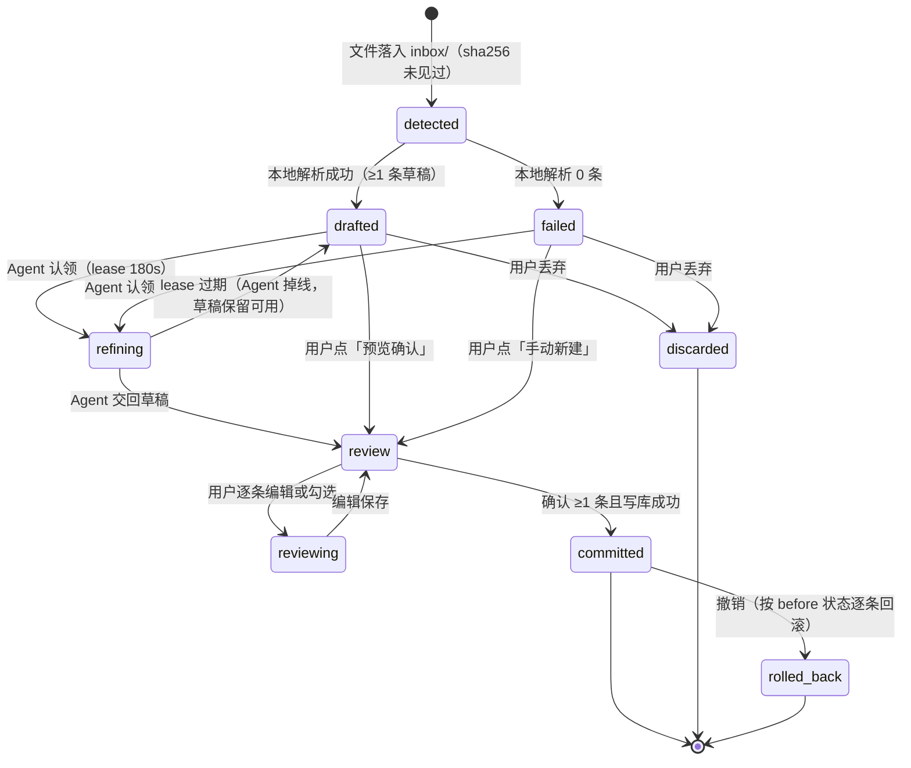
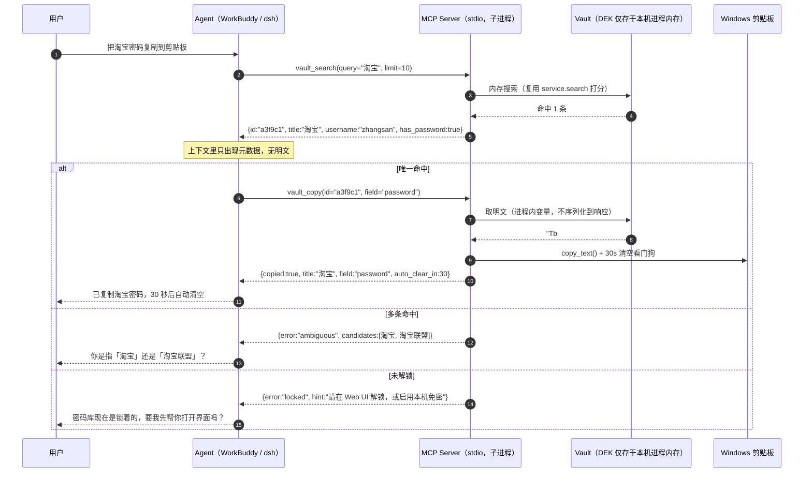
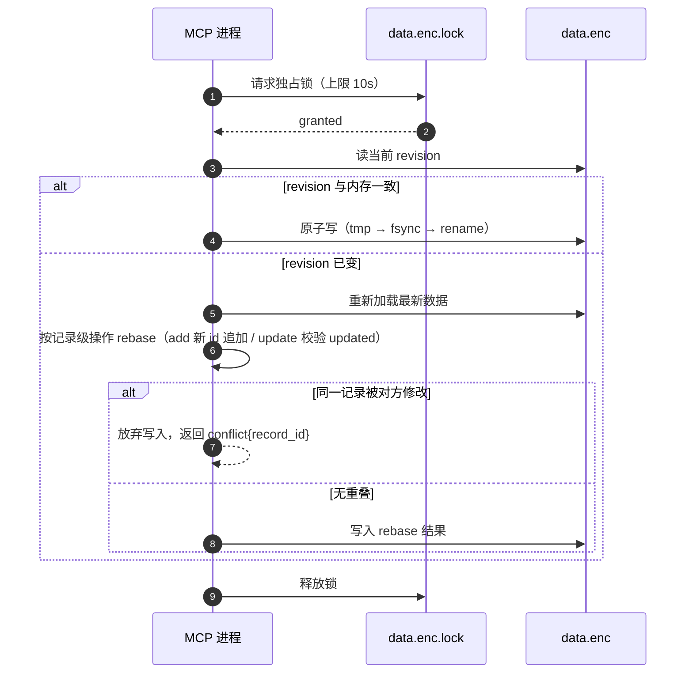

# pwdvault v1.1 增量 PRD

> 本文只描述**变更部分**。v1.0 已验收的加密、密钥结构、原子写、快照、三种解锁方式、自由字段模型，一律视为不可动摇的既定事实，不再复述也不得修改。

## 1. 项目信息

| 项 | 内容 |
|---|---|
| Language | 中文 |
| 项目 | `pwdvault` v1.1（在已有 v1.0 代码基础上增量迭代） |
| Programming Language | Python 3.11（后端） + 原生 HTML/CSS/JS（前端，**无构建步骤**） |
| 变更性质 | 新增 3 个入口（`pv web` / `pv mcp` / inbox 监听）、新增暂存区、新增并发写保护；**`data.enc` 文件格式与记录结构完全不变，无需迁移** |
| 原始需求复述 | 用户希望：① 把以前存的 TXT 丢进应用，由 Agent 自动整理成结构化记录；② 需要时对 Agent 说一句话就把密码复制出来；③ 能接入 WorkBuddy / deepseek-harness；④ 要有图形界面。 |

### 1.1 技术栈偏离说明（需架构师确认接受）

默认前端栈是 Vite + React + MUI + Tailwind，**本迭代建议不用**，理由：

1. 目标用户自认非资深开发者，要「开箱即用」；引入 Node + npm + 构建产物会让「装完就能跑」变成「先配前端工具链」。
2. 这是单人本地工具，页面总数 ≤ 7，状态复杂度低，构建带来的收益小于运维成本。
3. 现状项目已是纯 Python、零构建（`pv.py` 直接跑），保持一致。

**结论**：`pwdvault/web/` 下放静态 `index.html` + `app.js` + `app.css`，由 Python 直接托管；不引入 npm、不引入打包器。若架构师认为必须用 React，请在评审时提出，PRD 层面不阻塞。

后端新增依赖仅一个：官方 `mcp`（Python SDK，用于 stdio 协议正确性），且**必须是可选依赖**——不装 `mcp` 时 `pv` 的原有命令与 `pv web` 全部正常工作，只有 `pv mcp` 报「请先 pip install mcp」。禁止手搓 JSON-RPC。

---

## 2. 产品目标与成功标准

**一句话目标**：让「一堆明文 TXT」到「可被一句话取用的密码库」之间，只剩拖进去和点两下确认。

| 编号 | 成功标准 | 验证方式 |
|---|---|---|
| G1 | TXT 到入库全程 ≤ 3 次点击（拖入 → 提交确认 → 完成），无需命令行 | 手工走查 5 份真实风格 TXT |
| G2 | Agent 不可用时功能不被阻断：本地启发式解析仍能产出可确认的草稿 | 关掉 WorkBuddy 全流程走查 |
| G3 | 疑似解析错误（字段错位、密码含空格、一行两条）100% 在确认页出现可见警告 | 确定性规则单测 ≥ 25 条用例，用例集覆盖已知 8 类错误 |
| G4 | 「把 X 的密码复制到剪贴板」一次工具调用命中率 ≥ 90% | 20 条自然语言测试语句，统计首轮 `vault_copy` 命中数 ≥ 18 |
| G5 | 默认路径下明文密码进入 Agent 上下文的次数 = 0 | 审查 MCP 全部工具返回值定义 + 集成测试断言 |
| G6 | Web UI 与 MCP 并发写 100 次，零记录丢失 | 自动化并发测试（双客户端交替 add/update） |
| G7 | `pv web` 到可搜索 ≤ 3 秒（已开本机免密），冷启动含 Argon2 ≤ 3 秒 | 计时 |
| G8 | 回归：现有 69 个测试全绿；新增测试 ≥ 40 | `python -m unittest discover -s tests` |

---

## 3. 用户故事

### US-1 TXT 智能整理（Agent 在线）
**As a** 想整理旧资料的用户，**I want** 把一个乱七八糟的 TXT 拖进应用、由 Agent 整理好后让我逐条确认，**so that** 我不用手抄，也不会因为解析错位把密码存错。

**验收标准**
- AC1.1 拖入 `inbox/` 或 UI 拖拽区后 ≤ 2 秒，暂存区出现一个批次，状态显示「已识别 N 条 · 本地解析」。
- AC1.2 若 WorkBuddy 可用，批次可被 Agent 认领，状态变为「整理中（Agent）」，并在 180 秒内交回草稿；UI 无需刷新即更新。
- AC1.3 Agent 交回后状态变「待确认」，草稿**不落库**；库记录数不变（可断言）。
- AC1.4 确认页每条记录可编辑、可勾选忽略；底部固定显示「提交 N 条」。
- AC1.5 提交成功后库记录数 = 接受条数，且暂存批次状态「已入库」并保留 30 天可撤销。

### US-2 TXT 本地兜底整理（Agent 离线）
**As a** 用户，**I want** 即使 WorkBuddy 没开，文件也能被整理出一个可用的草稿，**so that** 我不会以为应用坏了。

**验收标准**
- AC2.1 WorkBuddy 完全未运行（无 MCP 客户端连接）时，拖入 TXT 仍产出「待确认」批次，来源标记「本地解析」。
- AC2.2 批次详情页顶部始终有一行状态说明，明确当前由谁整理、为什么（文案见 §10）。
- AC2.3 解析不出任何记录时，状态为「无法识别」，并给出两个出口：「手动新建」与「复制整理提示词去 Agent 里跑」。
- AC2.4 App 任何页面不得出现「失败 / 错误」这类让人以为数据出问题的措辞来描述「Agent 未连接」。

### US-3 说一句就复制
**As a** 用户，**I want** 对 Agent 说「把京东密码复制到剪贴板」就完成操作，**so that** 我不用打开 UI 找。

**验收标准**
- AC3.1 唯一命中时，一次 `vault_copy` 完成，返回体只含 `{copied:true, title, field, auto_clear_in}`，**不含明文**。
- AC3.2 多条命中时，工具返回结构化歧义错误 + 候选列表（id/标题/账号），Agent 据此反问用户，而不是猜。
- AC3.3 复制后 30 秒自动清空（沿用 v1.0 看门狗机制）。
- AC3.4 未解锁或凭据不可用时，返回 `locked` 错误码 + 可执行指引，不抛栈。
- AC3.5 说「我京东的账号是什么」→ `vault_search` 返回 username 明文（非密文字段），但密码仍为掩码。

### US-4 Web UI 增删改查
**As a** 用户，**I want** 在浏览器里搜索、查看、复制、新增、编辑、删除记录，**so that** 我不必记命令。

**验收标准**
- AC4.1 首屏是解锁页；解锁后进入三栏主界面，搜索框自动聚焦。
- AC4.2 输入关键词 ≤ 200ms 出结果（复用 `service.search` 打分，内存过滤，无需索引）。
- AC4.3 详情页密码默认掩码，点眼睛保持显示 15 秒后自动回掩码；复制按钮与 CLI 行为一致（含自动清空）。
- AC4.4 新增/编辑保存即原子落盘并生成快照；字段不存在时自动新建成自定义字段（沿用 `service.update` 语义）。
- AC4.5 删除需二次确认，确认框展示标题与账号，不展示密码。
- AC4.6 空闲 15 分钟自动锁定，回到解锁页并丢弃内存中的 DEK。

### US-5 双客户端并发
**As a** 同时开着 UI 和 Agent 的用户，**I want** 两边都不要把对方的改动吞掉，**so that** 我不丢数据。

**验收标准**
- AC5.1 UI 开着时，Agent 新增记录，UI ≤ 3 秒内自动出现该条并提示「已同步」。
- AC5.2 两人同时改同一条记录（外部先改），后提交方收到冲突提示，可选择「保留我的 / 采用新的」，绝不静默覆盖。
- AC5.3 两个客户端交替新增 100 条，最终条数 = 100，`revision` 单调递增。
- AC5.4 锁等待超时时给出「另一个窗口正在写入，请稍后重试」而非崩溃。

### US-6 开箱即用接入
**As a** 用户，**I want** 设置页直接给我一段可复制的 MCP 配置，**so that** 我不用查文档猜路径。

**验收标准**
- AC6.1 设置页展示一段完整 JSON（含 python 绝对路径、`pv.py mcp` 参数、`PV_VAULT` 环境变量），一个「复制」按钮。
- AC6.2 同时给出 WorkBuddy 与 deepseek-harness 两个粘贴位置的说明（各 1 行）。
- AC6.3 复制后能在客户端里看到 `vault_*` 工具列表——这是接入成功的判据，需写在页面上。

---

## 4. 五个必须先定下来的产品决策

这五条决定了架构形态，请架构师按此实施，不要再设计替代方案。

### 决策 1：treat「自动整理」为**双生产者、单通道**，而不是「应用去调模型」

应用不持有 API key，也**无法主动唤醒 Agent**（MCP 是 stdio，只能被客户端调用）。硬要「自动」会做出一个依赖轮询、必然失败的伪异步。正确切法是：

> **暂存区（staging）是唯一入口；本地启发式解析器和 Agent 是两个「草稿生产者」，谁先产出用谁，后到的可覆盖未被人编辑的草稿。**

由此三条推论：
1. **降级是免费的**：Agent 不在 = 少一个生产者，不是功能缺失。本地解析器（现成的 `importers.parse_any`）永远在，所以「已识别 N 条」立刻可见，用户随时可以确认入库。
2. **「自动」= 文件被自动发现**（inbox 监听，2 秒轮询 mtime + sha256 去重），**不是**「自动被模型处理」。这点必须在 UI 上写清楚，不要用「AI 整理中」这种会让人误以为必须等待的文案。
3. **Agent 是「拉」模式**：Agent 通过 `vault_staging_list` / `vault_staging_claim` 主动领取任务。触发点是用户对 Agent 说「有需要整理的吗」或客户端自带的会话启动钩子——应用不假装能推送。

### 决策 2：整理结果必须**预览后落库**，Agent 永远没有 commit 权限

硬规则：

> **多记录写入只能由人在 UI 上确认；Agent 的工具集里不存在任何能批量落库的工具。**

- Agent 只能调 `vault_staging_submit`（写草稿），不能调 commit。
- 单条 `vault_add` / `vault_update` 允许 Agent 直写（否则「帮我加一条」做不了），但必须带 `dry_run` 预演语义、写入审计、并在 UI 上打「由 Agent 写入」标记。
- 批量导入走暂存区 → 人确认 → 落库。这条线不可绕过。

### 决策 3：明文默认不出进程；`copy` 是**有副作用无返回值**的工具

用户真实意图里有两种，产品上必须分开：

| 用户说 | 意图 | 走哪个工具 | 明文去哪 |
|---|---|---|---|
| 「把淘宝密码复制到剪贴板」 | 要用（粘贴到别处） | `vault_copy` | 只进 Windows 剪贴板，**不进对话** |
| 「我京东的账号是什么」 | 要看 | `vault_search` | username 属非密文字段，可返回 |
| 「把 AccessKey Secret 念给我」 | 要看密文 | `vault_reveal`（P1） | 进对话 + 写审计 + 返回强警告 |

**为什么这很重要**：Agent 的上下文会进日志、进历史、可能被下一轮再发给模型。一旦密码进了对话历史，这个密码就等于泄露给所有能看到该会话的人和系统。所以 `vault_copy` 的返回值必须是**结果回执**，不是数据。工具描述里要显式写：「本工具不返回明文，复制即完成」。

同时要给 Agent 一条**歧义回流**的通道：`vault_search` / `vault_copy` 匹配到多条时，返回 `{error:"ambiguous", candidates:[{id,title,username}]}`，让 Agent 反问用户「是淘宝还是淘宝联盟」。这是「一次说对」的关键——不是让模型更聪明，是让工具把不确定性还给用户。

### 决策 4：并发用**单文件锁 + 记录级 rebase**，不用「检测到变化就拒绝」

v1.0 的 `Vault.save()` 用内存里的 `revision` 直接覆盖，两个进程同时写会静默丢数据（列表整体覆盖）。必须修，但**不要**做成「检测到文件变了就报错」——用户会频繁遇到，体验很差。

规则：

1. 写前对 `data.enc.lock` 取**独占锁**（Windows 用 `msvcrt.locking`），等待上限：UI 3 秒 / MCP 10 秒。
2. 拿到锁后**重读磁盘 `revision`**，与内存比对。
3. 不一致 → **rebase**：重新从盘上加载 → 把我们这次改动按**记录级操作**（add 列表 / update 的 record_id + 字段集 / delete 的 id）重放到最新数据上 → 写。`add` 天然无冲突（新 id 追加）。
4. 仅当**同一条记录**被两边都改过（`updated` 时间戳不一致）→ 返回 `conflict{record_id, mine, theirs}`，由人裁决。
5. UI 通过 SSE 订阅 `revision` 变化，外部写入后自动刷新并 toast「已同步（+2 条）」；若用户正在编辑冲突记录，弹「保留我的 / 采用新的 / 并排看」。

**P1 优化（能显著简化以上复杂度）**：Web 进程启动时写 `runtime.json`（端口 + 一次性 token，权限 0600）。MCP 进程检测到它就**代理转发**到 Web 进程执行，全局只有一个写者和一份 DEK；探测不到才自己持锁自解锁。这条列为 P1 是因为它要求「UI 必须先开」，与「Agent 随时可用」有冲突，不能作为唯一路径。

### 决策 5：UI 是**本地工具**，不是后台系统

- 不做登录页/头像/角色/权限/团队/计费，任何 SaaS 语汇都不许出现。
- 信息架构按「找 → 看 → 复制」的肌肉记忆排，不是「模块 → 菜单 → 表单」。
- 主界面是**三栏常驻布局**（列表 + 详情同屏），不做列表点击跳详情页再返回，那是移动端范式。
- 复制是最高频动作，必须一键可达（行 hover、详情页按钮、`Ctrl+Shift+C`）。

---

## 5. 核心流程图

### 5.1 TXT 智能整理（完整状态流转）



**关键约束**
- `review` / `reviewing` 期间批次**加编辑锁**（记录持有者与开始时间），Agent 的 `vault_staging_submit` 被拒绝并返回「该批次正在被人工编辑」。避免边看边变。
- `refining` 是唯一允许「僵尸」的状态，靠 lease 自愈；UI 上「整理中」超过 180 秒自动回落为「待确认（本地解析）」。
- 任何状态都不阻塞用户：`refining` 中的批次也允许用户直接「就按本地结果确认」。

### 5.2 Agent 取密码（时序）



### 5.3 并发写入（记录级 rebase）



---

## 6. 暂存区状态机

### 6.1 批次状态定义

| 状态 | UI 文案 | 含义 | 允许的操作 |
|---|---|---|---|
| `detected` | 已发现 | 文件已入库记录源哈希，尚未解析 | 解析（自动）、丢弃 |
| `drafted` | 待确认 · 本地解析 | 本地启发式解析出 ≥1 条草稿 | 预览、请 Agent 整理、丢弃、直接确认 |
| `failed` | 无法识别 | 本地解析 0 条 | 手动新建、复制提示词给 Agent、丢弃 |
| `refining` | 整理中 · Agent | Agent 已认领并持有 lease | 放弃等待（回落 drafted）、强制按本地结果确认 |
| `review` | 待确认 · Agent 整理 | Agent 已交回草稿，等待人工确认 | 逐条编辑/勾选、提交、丢弃 |
| `reviewing` | 确认中 | 用户正在编辑（持编辑锁） | 保存、提交、丢弃 |
| `committed` | 已入库 | 已写入 vault，保留 30 天 | 撤销（按 before 逐条回滚）、删除原始文件 |
| `rolled_back` | 已撤销 | 撤销完成 | 查看详情 |
| `discarded` | 已丢弃 | 用户放弃，源哈希进墓碑表 | 重新导入 |

### 6.2 转换条件

| 从 | 到 | 触发 | 附加条件 |
|---|---|---|---|
| `detected` | `drafted` | 解析任务完成 | `parse_any` 返回 ≥1 条 |
| `detected` | `failed` | 解析任务完成 | 0 条或抛 `ImportError_` |
| `detected` / `drafted` / `failed` | `refining` | `vault_staging_claim` | 当前无有效 lease；批次不在 `review*` |
| `refining` | `review` | `vault_staging_submit` | 须持有效 lease；记录通过 `Record.from_dict` 校验；逐条生成警告 |
| `refining` | `drafted` | lease 过期（180s） | 有本地草稿则回落 `drafted`，否则 `failed` |
| `drafted` / `failed` / `refining` | `review` | 用户点「预览确认」 | 释放 lease |
| `review` | `reviewing` | 用户开始编辑某条 | 获取编辑锁（单持有者） |
| `reviewing` | `review` | 保存/失焦 | 释放编辑锁 |
| `review` / `reviewing` | `committed` | 用户点「提交 N 条」 | N ≥ 1；写库成功（含 rebase） |
| `review` / `reviewing` | `discarded` | 用户丢弃 | 二次确认 |
| `drafted` / `failed` | `discarded` | 用户丢弃 | — |
| `committed` | `rolled_back` | 用户撤销 | ≥1 条能被 before 状态回滚；回滚失败则保持 `committed` 并报错 |

### 6.3 条目级状态与冲突

条目（item）字段：`{draft: Record, origin: "local"|"agent", accepted: bool, edited: bool, warnings: [...], conflict: {...}, before: {...}}`

- `warnings[]` 由**本地确定性规则**生成，不交给模型判断。8 类规则（全部要有单测）：
  1. 缺标题 → `error`（不可提交）
  2. 无账号且无密码 → `warn`「可能是注释行」
  3. 密码首尾有空格被裁剪 → `warn`「密码两端有空格，已去除」
  4. 账号形如 `^1[3-9]\d{9}$` → `info`「账号看起来是手机号」
  5. 密码 == 账号 → `warn`
  6. 长度 > 128 的值被当作密码 → `warn`「可能把整段文本当成了密码」
  7. 非 totp 字段出现 Base32（≥16 位）→ `info`「可能是 TOTP 种子」
  8. 与现有记录 title+username 重复 → `conflict`，三选一：跳过 / 覆盖 / 新建副本（默认跳过）
- `before`：若提交动作是「覆盖已有记录」，存该记录提交前的字段快照，用于撤销。

---

## 7. MCP 工具能力清单

### 7.1 通用约定（必须先落地，否则工具再多也不可靠）

- **命名**：全部 `vault_` 前缀，动词结尾语义明确（`search`/`copy`/`add`），描述里写「什么时候用我」而不是「我做了什么」。
- **入参**：`id` 与 `query` 二选一，`id` 优先；两者同时给时以 `id` 为准并在返回值里 `note` 提示。
- **返回**：一律 `application/json`；错误用 `isError: true` + `{code, message, hint, candidates?}`，`code` 复用 `errors.py` 的 `VaultError.code`（CLI 与 MCP 同一套错误语汇）。
- **安全**：除 `vault_reveal` 外，任何工具不得在返回值中出现 `password` / `totp` 种子 / 敏感自定义字段的值。掩码统一 `••••`（长度不泄露）。
- **敏感字段识别**：字段名（小写、去空格）含 `secret|key|token|pass|pwd|pin|seed|私钥|密钥|令牌|口令|种子` 即视为敏感；或以 `*` 开头的字段名（如 `*AccessKey Secret`）为人工强制标记。`*` 写法不改 payload 结构，v1.0 打开只是多显示一个星号，向前兼容。
- **副作用**：`vault_copy` / `vault_add` / `vault_update` 会改本机状态，返回体必须能让 Agent 向用户复述结果（含标题与字段名，不含值）。

### 7.2 工具表

| 工具名 | 用途（给 Agent 看的一句话） | 入参 | 返回 | 安全约束 |
|---|---|---|---|---|
| `vault_status` | 库是否可用、锁没锁、有几条、有几件待整理。任何操作前想了解现状时先调这个 | 无 | `{exists, unlocked, revision, count, auto_lock_in_seconds, pending_staging, inbox_pending, last_snapshot_age_days}` | 无敏感数据 |
| `vault_search` | 按关键词模糊找记录，拿到 id 后用于 copy 或 get。用户说「我的 X」但不确定是哪条时先用我 | `query`（支持 `tag:` / `user:` / `title:` 前缀）, `limit`（默认 10） | `{count, records:[{id,title,username,url,tags,has_password,has_totp,secret_field_names,updated}]}` | 不含密码；敏感字段只给名字不给值 |
| `vault_get` | 看某一条的详情（备注、自定义字段），不包含任何密文 | `id` | 单条 + `notes` + 非敏感自定义字段值 + 敏感字段名 | 密文/敏感值一律 `••••` |
| `vault_copy` | **把某个字段的值复制到用户剪贴板**。用户要「用」密码/账号/网址/动态码时用我。我不返回明文 | `id` 或 `query`, `field`（默认 `password`；可选 `username`/`url`/`totp`/自定义字段名） | `{copied:true, title, field, auto_clear_in}` 或 `ambiguous` / `not_found` / `locked` | **绝不返回明文**；30 秒后自动清空；写入审计 |
| `vault_totp` | 取当前 6 位动态码（用户要登录时的验证码）。码 30 秒失效 | `id` 或 `query` | `{code, remaining_seconds, title}` | 允许返回（短时效）；不写审计（高频） |
| `vault_add` | 新增**单条**记录。用户明确说「帮我加一条」时用；批量请走暂存区 | `record{}`, `dry_run`（默认 true） | `{created, id, warnings[]}` | 先 dry_run 返回警告，用户确认后再 real；写审计；UI 打「由 Agent 写入」 |
| `vault_update` | 修改**单条**记录的字段 | `id`, `changes{}`, `expected_updated`（乐观锁） | `{updated:true, id}` 或 `{conflict:{record_id,mine,theirs}}` | 需 `expected_updated`；冲突必须回传由用户裁决 |
| `vault_staging_list` | 列出待整理的批次（用户问「有需要整理的吗」时用） | `status?`（默认全部未完成） | `{batches:[{id,source_file,status,item_count,origin,age_seconds}]}` | 不含正文 |
| `vault_staging_claim` | 认领一个待整理批次并取回原文，用于归纳成结构化记录 | `batch_id`, `lease_seconds`（默认 180，上限 600） | `{batch_id, raw_text, local_draft[], warnings[], max_items_hint}` | **原文会进入上下文**（这是整理的固有代价）；lease 防僵死；单批次 ≤ 200KB，超出返回分片游标 |
| `vault_staging_submit` | 交回归纳结果（只写草稿，不落库）。提交后用户在 UI 里确认 | `batch_id`, `records[]`, `summary?` | `{accepted, item_count, warnings_by_item[]}` | 无 commit 能力；批次在 `review*` 时拒绝并提示「正在人工编辑」 |
| `vault_reveal`（P1） | 在对话里显示明文。**仅当用户明确要求在此对话中看到**时使用；能用 copy 就不要用我 | `id`, `field`, `confirm`（必须 true） | `{value, warning}` | 写审计（含字段名，不含值）；返回体附「此值已进入对话历史」警告 |

**刻意不提供的工具**（防止 Agent 越界）：`vault_delete`、`vault_import_batch`、`vault_staging_commit`、`vault_change_master_password`、`vault_export`。删除与主密码属于高危操作，只允许在 Web UI 由人操作。

### 7.3 MCP 进程的解锁策略

stdio 的 stdin 被协议占用，**不可能交互式输入主密码**。优先级：

1. 探测 `runtime.json`（Web UI 在跑）→ 走代理，不需要自己解锁（P1）。
2. 本机免密（DPAPI）可用 → 直接解锁。
3. `PV_MASTER_PASSWORD` 环境变量（写在客户端配置里）→ 用它解锁。
4. 都不行 → 返回 `locked` 错误 + `hint`：「先运行 `pv web` 解锁，或 `pv local-unlock on`」。

进程内解锁后保持 DEK 于内存，空闲 `auto_lock_seconds`（默认 900 秒）后丢弃，下次调用重新走上面的链。**不做**「把主密码写到磁盘任何位置」。

---

## 8. Web UI 信息架构

### 8.1 页面/视图清单

**① 解锁视图（首次进入 / 自动锁定后）**
- 居中单卡片，无导航。元素：库路径（次要字号）、主密码输入框（自动聚焦，Enter 提交）、「用恢复码解锁」折叠、本机免密按钮（仅 `dpapi` 可用时出现，文案「用这台电脑直接进入」）、错误提示区（复用 `AuthenticationFailed` 文案+ hint）。
- 无注册、无找回、无第三方登录。忘记密码 → 折叠区里给出恢复码说明与「用快照恢复」链接（指向 README 段落）。

**② 主界面（三栏常驻）**
- **左栏（220px，可折叠）**：全局搜索框（`Ctrl+K` 聚焦）、视图切换（全部 / 收藏 / 最近使用 / 无密码 / 有 TOTP）、标签列表（含计数）、底部固定入口：待整理（带数字徽标）、健康检查、设置。
- **中栏（列表，虚拟滚动）**：每行 = 标题 · 账号 · 标签 chips · 悬停出现「复制密码 / 编辑」。键盘：↑↓ 移动、Enter 复制密码、Ctrl+Enter 看详情。列表头显示「共 N 条 · 修订 42」。
- **右栏（详情）**：标题行（inline 编辑）+ 字段表（账号/密码/网址/动态码/标签）+ 自定义字段区（敏感字段默认掩码 + 眼睛）+ 备注 + 页脚元信息（创建/更新/由 Agent 创建）。操作：复制密码（主按钮）、复制账号、打开网址、编辑、删除（危险色，二次确认）。
- **顶部状态条**：库已锁/已解锁、修订号、`已同步` / `另一个窗口写入了更新` 的轻提示、Agent 连接状态（`Agent 已连接` / `Agent 未运行`，仅信息性，不报警）。

**③ 待整理（暂存区）**
- 顶部拖拽区：「把 TXT / CSV / JSON 拖到这里」，旁附「打开 inbox 文件夹」按钮与监听状态（`正在监听 G:\...\inbox`）。
- 左列：批次卡片（文件名、来源标记「本地解析 / Agent 整理」、条数、相对时间、状态色点）。
- 右列：条目卡片流。每张卡 = 可编辑字段表单（标题/账号/密码/网址/标签/备注/自定义）+ 顶部状态（勾选接受 / 忽略）+ 警告条（按 `warn`/`info`/`conflict` 分色，冲突条内嵌三选一）。
- 底部固定操作条：`全选 / 全部接受`、`提交 N 条`（主按钮，N 为已接受数，0 时禁用）、`丢弃整个批次`。
- 空状态文案：「这里会放需要你确认的整理结果。把文件拖进来试试。」

**④ 健康检查**
- 四张统计卡：弱密码数、密码复用组数、超 365 天未换、无密码条目。下方两个列表：弱密码（标题 + 熵值 + 等级）、复用组（密码相同的一组标题，**不显示密码**）。
- 底部「备份提醒」：距上次快照天数、`data.enc` 所在目录是否看起来像网盘同步目录（路径含 `OneDrive`/`坚果云`/`Dropbox`/`Google Drive` 时给正向提示）。

**⑤ 设置**
- 分四块：安全（改主密码、重新生成恢复码、本机免密开关、自动锁定分钟数、剪贴板清空秒数）、整理（inbox 目录选择、是否自动监听、默认重复策略 `跳过/覆盖/新建副本`）、接入（MCP 配置 JSON + 复制按钮 + WorkBuddy/dsh 粘贴位置说明）、维护（打开库目录、打开快照目录、执行体检导出）。
- 危险区单独一块，红边框：改主密码、重置恢复码，需输入当前主密码。

**⑥ 审计（P1）**
- 时间倒序表格：时间 / 来源（UI/Agent 名）/ 动作（读字段名/新增/修改/复制）/ 目标（标题 + id）。**只记录字段名，不记录值**。

### 8.2 本地 HTTP 接口一览（供架构师与前端对齐）

| 方法 | 路径 | 说明 |
|---|---|---|
| POST | `/api/unlock` | `{password}` 或 `{recovery_code}` 或 `{use_dpapi:true}` |
| POST | `/api/lock` | 丢弃内存 DEK |
| GET | `/api/session` | 是否已解锁、修订号、Agent 连接状态 |
| GET | `/api/records?q=&tag=&limit=` | 搜索/列表（不含密码） |
| GET | `/api/records/{id}` | 单条（密码掩码，`?reveal=1` 需前端二次点击且记录审计） |
| POST | `/api/records` | 新增 |
| PATCH | `/api/records/{id}` | 修改（带 `expected_updated`） |
| DELETE | `/api/records/{id}` | 删除（带 `confirm_title` 校验） |
| POST | `/api/records/{id}/copy` | 服务端写剪贴板，返回回执 |
| GET | `/api/staging` | 批次列表 |
| GET | `/api/staging/{id}` | 批次详情（条目 + 警告） |
| POST | `/api/staging/{id}/items` | 保存条目编辑 |
| POST | `/api/staging/{id}/commit` | 提交入库（原子） |
| POST | `/api/staging/{id}/discard` | 丢弃批次 |
| POST | `/api/staging/{id}/rollback` | 撤销已入库批次 |
| POST | `/api/inbox/upload` | 拖拽上传（写 inbox 后走监听流程） |
| GET | `/api/health` | 体检数据（复用 `service.health`） |
| GET | `/api/events` | SSE：`revision` 变化、暂存批次状态变化、Agent 连接变化 |

**本地服务的安全要求（P0，不可省）**
- 仅 `127.0.0.1`，端口默认 8765，被占用时顺延并在终端打印实际地址。
- 校验 `Host` 头必须是 `127.0.0.1:<port>` 或 `localhost:<port>`（防 DNS rebinding）。
- 启动时生成一次性 session token，写入 `runtime.json` 与 HttpOnly + `SameSite=Strict` Cookie；所有 `/api/*` 校验。不发任何 CORS 头。
- 静态资源只从包内目录读，禁止路径穿越。

---

## 9. 数据与文件布局变更

```
<vault 目录>/
  data.enc                 ← 不变，格式不动
  snapshots/               ← 不变
  config.toml              ← 新增 [web] [inbox] [mcp] [staging] 段
  runtime.json             ← 新增：Web 进程运行时信息（port/token/pid），0600，退出即删
  data.enc.lock            ← 新增：写锁文件
  inbox/                   ← 新增：用户丢文件的地方
    processed/             ← 已入库的源文件移到这里（保留原文件，供用户自行删除）
  staging/                 ← 新增：批次元数据
    <batch_id>.enc         ← 草稿加密存储（同一 DEK，AAD 绑定 vault_id + "staging"）
  staging/tombstones.json  ← 新增加密清单：已丢弃文件的 sha256，防重复打扰
  logs/audit.jsonl         ← P1：只记字段名与动作，不记值
```

**三条硬性要求**
1. **暂存区草稿必须加密落盘**。TXT 里的密码是明文，草稿如果明文存 `staging/xxx.json`，等于在库旁边放了一份明文——直接违背 v1.0 的全部承诺。加密方式复用现有 `crypto` 原语，AAD 用 `vault_id + "staging"`，不得新造密钥。
2. **原始 TXT 保持明文**（那是用户自己的文件），但入库后必须显式提醒：「原始文件仍是明文，建议删除」并提供一键删除按钮（默认不勾选，不替用户做破坏性动作）。
3. `data.enc` 的 payload schema 不升级。新增状态全部在库外文件里。

---

## 10. 需求池

### P0（本次必做）

按实施顺序分三批，便于并行：

**P0-a 地基（无 UI 也应可测）**
1. `locks.py`：`data.enc.lock` 独占锁 + `revision` 校验 + 记录级 rebase + `conflict` 语义；`Vault.save(expected_revision=...)` 改造。
2. `staging.py`：批次/条目模型、状态机、加密持久化、条目级校验（8 类警告规则）、commit / rollback。
3. `inbox.py`：目录扫描（2 秒 mtime 轮询 + sha256 去重 + 墓碑表）、processed 归档。
4. MCP 只读工具：`vault_status`、`vault_search`、`vault_get`、`vault_copy`、`vault_totp`。

**P0-b 界面闭环**
5. `web/`：HTTP 服务 + 安全三件套（Host 校验 / token / 无 CORS）+ SSE + 静态资源。
6. 解锁视图、主界面三栏、详情复制/编辑/删除、健康检查、设置（含 MCP 配置一键复制）。
7. `pv web` 命令（启动后自动打开浏览器）。

**P0-c Agent 整理闭环**
8. MCP 整理工具：`vault_staging_list` / `vault_staging_claim` / `vault_staging_submit`。
9. MCP 写工具：`vault_add` / `vault_update`（dry_run + 乐观锁）。
10. 待整理页（批次 + 条目确认 + 冲突三选一 + 撤销）。
11. `pv mcp` 命令 + `pv pyproject` 里的 optional dependency `mcp`。
12. SSE 双端同步（UI 自动刷新 / Agent 写入提示）。

### P1（可延后，但设计要预留）

- `vault_reveal`（明文进对话，带审计与警告）。
- 代理模式：MCP 转发到运行中的 Web 进程（单写者，省一次解锁）。
- `vault_health`（Agent 回答「我哪些密码弱」）。
- 审计日志页面 + `audit.jsonl`。
- 密码生成器（UI + MCP `vault_generate`），生成后可直接写入字段。
- 批次撤销的「一键回滚所有已入库批次」（按时间窗口）。
- 全文搜索索引（当前几百条用内存打分足够，超 2000 条再说）。

### P2（明确不做，含理由）

| 不做 | 理由 |
|---|---|
| Agent 直接批量落库 / `vault_staging_commit` 暴露给 MCP | 破坏「人工确认」这一唯一的安全闸门，一次模型幻觉就是批量脏数据 |
| 应用内置 API key / 直连大模型 API | 用户已定：复用 WorkBuddy Agent。自建通道等于把密钥管理责任搬进本项目，与零知识定位冲突 |
| 云端同步集成（OneDrive/Dropbox API） | v1.0 的设计就是用「用户自己丢网盘」规避这件事；接 API 会引入 OAuth token 这一新的密钥面 |
| 多用户 / 共享 / 权限 / 团队 | 单人自用，任何账号体系都会立刻要求服务端，破坏「无服务器」前提 |
| 浏览器扩展 / 自动填充 | 需要注入网页上下文，等于把明文暴露给浏览器 DOM，直接违背「密钥不出 Python 进程」 |
| 移动端 / 跨设备实时同步 | 数据规模与场景不需要；跨设备用「主密码 + 网盘文件」已经解决 |
| 局域网访问 / 绑定 0.0.0.0 | 会让「本机工具」变成「网络服务」，攻击面数量级上升 |
| 明文日志、错误信息里带字段值 | 一旦进日志就等于永久泄露；所有日志只允许 id、字段名、条数 |
| 记录附件 / 文件存储 | 单文件 `data.enc` 的结构不适合存二进制，且会撑大加密负载；超出本迭代目标 |
| 竞品分析与市场定位 | 自用工具，无商业目标 |

---

## 11. 对现有代码的改动落点（给架构师）

| 文件 | 改动 |
|---|---|
| `vault.py` | `save(expected_revision=None)`；`revision` 不一致抛/返回冲突信号；新增 `snapshot_now()` 供 commit 前显式打点；`_snapshot()` 逻辑不变 |
| `service.py` | `merge_import` 支持 `apply=False` 时逐条返回 `warnings`（当前只返回计数）；抽出 `validate_records()` 供暂存区与 MCP 共用；新增 `copy_field(record, field)` 供 UI/MCP 统一走 clipboard |
| `models.py` | 不改结构。新增 `is_sensitive_key(name)` 与 `mask_value()` 工具函数；`to_dict(mask_secrets=False)` 增加可选掩码参数 |
| `importers.py` | 不动解析逻辑。`parse_any` 增加可选 `source_name` 参数以填 `导入备注`（已有字段，复用） |
| `config.py` | 新增 `web`（port/host/token TTL）、`inbox`（dir/watch interval/enabled）、`staging`（lease seconds/ttl days/max bytes）、`mcp`（auto_lock/idle proxy）四组配置 |
| `errors.py` | 新增 `LockTimeout`、`RecordConflict`、`StagingBusy`、`Locked`（`code` 分别为 `lock_timeout`/`record_conflict`/`staging_busy`/`locked`） |
| 新增 | `locks.py`、`staging.py`、`inbox.py`、`web/`、`mcp_server.py`、`audit.py`(P1) |
| `cli.py` | 新增 `web` / `mcp` 两个子命令；`__init__.py` 版本号 → 1.1.0 |

**测试要求（新增 ≥ 40）**
- 锁与 rebase：并发 100 次写不丢；冲突用例；锁超时。
- 状态机：13 条转换每条至少 1 例，含 lease 过期回落。
- 校验规则：8 类警告各 1 例 + 误报反例。
- MCP：10 个工具的参数校验 + 返回体断言（**断言返回 JSON 里不含任何真实密码字符串**，用一个哨兵密码做探针）。
- 安全：Host 头伪造被拒、无 token 被拒、路径穿越被拒。
- 回归：现有 69 个不动。

---

## 12. 待确认问题（只列需要用户拍板的风险偏好项，已定决策不重复问）

每条都给出**建议默认值**，架构师不必等待——按建议先做，用户若否决再改。

| # | 问题 | 建议默认 |
|---|---|---|
| Q1 | **dsh / WorkBuddy 是否与本应用同一台机器？** `vault_copy` 把密码写进的是「MCP 进程所在机器的剪贴板」。若 Agent 跑在容器/远程主机，复制会写到那台机器，用户在自己屏幕上粘贴不到。 | 按「同机」设计；实现时 `vault_copy` 返回值里带上主机名，便于用户察觉异常 |
| Q2 | **inbox 目录放哪？** 若放在网盘同步目录里，其他客户端回传文件可能触发重复批次。 | 默认 `<vault 目录>/inbox`；若检测到 vault 在网盘里，设置页给一行提醒 |
| Q3 | **TOTP 动态码允许明文返回给 Agent 吗？**（我倾向允许：30 秒失效，且用户本来就要看到才能用） | 允许，不写审计 |
| Q4 | **审计日志的粒度。** 记录「Agent 读过哪些条目的哪些字段」能提升可追溯性，但日志本身是本机明文文件。 | P1 才做；只记 id + 字段名 + 时间，永不记值；可在设置里整体关闭 |
| Q5 | **允许 Agent 单条直写（`vault_add`/`vault_update`）吗？** 不允许则「帮我加一条」这个自然请求做不了；允许则有一次未经确认的写入风险（有快照兜底）。 | 允许，但必须 `dry_run` 先返回警告，UI 打「由 Agent 写入」标记 |
| Q6 | **关掉浏览器后 `pv web` 进程是否继续驻留？** 驻留 = MCP 可代理、后台可监听 inbox；不驻留 = 更省心，但 Agent 每次要自己解锁。 | 不驻留（前台进程，Ctrl+C 结束）；`pv web --daemon` 作为 P1 附加选项 |
| Q7 | **默认重复策略**：导入时遇到同 title+username 已存在，默认「跳过 / 覆盖 / 新建副本」？ | 跳过（沿用 v1.0 `--mode skip`），暂存区每条可单独改 |

---

## 13. 附：降级与状态文案（避免「以为坏了」）

| 场景 | 文案 | 禁止的写法 |
|---|---|---|
| Agent 未连接 | `Agent 未运行。当前由本地规则解析，你可以直接确认或等 Agent 上线后重新整理。` | 「智能整理失败」「AI 不可用」 |
| 批次在整理中 | `Agent 正在整理·已用时 42 秒（超过 3 分钟会自动回到本地结果）` | 「请稍候…」无上限等待 |
| 本地解析 0 条 | `这份文件我没看懂。你可以手动新建，或把整理提示词复制到 WorkBuddy 里让它处理。` | 「解析错误」 |
| 写冲突 | `这条记录刚被另一个窗口改过。` + 三选一按钮 | 「保存失败」 |
| 锁等待超时 | `另一个窗口正在写入，稍等一下再试。` | 「数据库忙」 |
| 未解锁时调 MCP | `密码库现在是锁着的。先打开界面解锁，或开启本机免密。` | 「权限不足」 |
| 剪贴板被占用 | `剪贴板被别的程序占着，请稍后再点一次。` | 「复制失败」 |
